# Dogs vs. Cats: Binary Image Classification with Transfer Learning

EE6483 Artificial Intelligence and Data Mining, Mini Project, Option 2
Group report · 13 November 2026

| Member | Matriculation | Contribution | Questions answered |
|---|---|---|---|
| *name to be filled* | *matric to be filled* | 34% | a(1) to a(4), f |
| *name to be filled* | *matric to be filled* | 33% | a (data), b, c, d |
| *name to be filled* | *matric to be filled* | 33% | e, g, h |

## Abstract

This report studies binary cat/dog classification on 20,000 training images, 5,000 validation images and 500 unlabelled test images. Six classifiers are compared under a single pipeline: hand-crafted HOG features with an SVM, a small CNN trained from scratch, a frozen ImageNet ResNet-18 with a linear head, and fine-tuned ResNet-18, ResNet-34 and ResNet-50 models.

The main model, an ImageNet-pretrained ResNet-18 fine-tuned with the LP-FT schedule, reaches 98.93 ± 0.05% validation accuracy over three seeds. A three-seed ensemble with horizontal-flip test-time augmentation raises this to 99.22% and produces the submitted predictions.

A one-factor-at-a-time ablation ranks the design choices by the size of their effect. Pre-training is the largest factor, worth 7.46 points at a fixed budget. Training-set size is second: accuracy rises from 93.56% with 500 images to 98.12% with 20,000 and saturates beyond 10,000. The depth of fine-tuning (1.88 points) and the input resolution (0.64 points from 160 to 224 pixels) are third-order. Augmentation moves accuracy by less than half a point at all three budgets tested, with the sign depending on the schedule. Backbone choice is a small effect. A controlled comparison of seven ImageNet backbones at a fixed budget, two seeds each, spans 99.24% to 99.61%: ConvNeXt-T, ResNet-50 and Swin-T form a top tier about 0.3 points above ResNet-18/34, EfficientNet-B0 and ViT-B/16, and the ranking follows the ImageNet accuracy of the pretrained weights rather than the number of parameters (ViT-B/16, still improving at the end of the budget, is the exception).

An analysis of all 50 validation errors shows that two thirds arise when the animal is not presented as in the training set, either because the face is hidden or because the animal is behind a fence or held in a hand. Grad-CAM attributes correct predictions to the animal's head rather than to the scene. Accuracy falls by 12.7 points under heavy blur, but by only 1.1 points under 30° rotation and 0.4 points under 25% occlusion.

The pipeline is then applied to CIFAR-10, where the ImageNet stem must be replaced by a 3×3 stride-1 stem to avoid destroying a 32-pixel image. Training from scratch reaches 93.60% test accuracy and ImageNet pre-training reaches 95.20%. On a long-tailed CIFAR-10 variant with a 90:1 imbalance ratio, five remedies are compared against plain cross-entropy. Post-hoc logit adjustment performs best, raising test accuracy from 62.44% to 72.99% and macro-F1 from 60.27% to 72.96% without retraining.

Keywords: transfer learning, ResNet, fine-tuning, data augmentation, Grad-CAM, long-tailed recognition, CIFAR-10

---

## Contents

1. Literature Survey
2. Dataset and Pre-processing
3. Model and Training Procedure
4. Hyper-parameter Selection
5. Results
6. Error Analysis
7. Ablation Study
8. Extension to CIFAR-10
9. Class Imbalance
10. Conclusion

References

Appendix: complete experiment log

---

## Declaration

All experiments, results and analysis in this report were produced by the group for this project, using the code in `ee6483/` and the commands listed in Appendix A.5. Where external libraries, pre-trained weights or generative tools were used, they are identified at the point of use; all experimental design, results and interpretation are the group's own. We have read and uphold the NTU Honour Code.

---

<div style="page-break-after: always;"></div>

# 1. Literature Survey

> EE6483 Mini Project (Option 2: Dogs vs. Cats)
> Group members and contributions: see front matter.

## 1.1 Problem definition, settings and challenges

### 1.1.1 Formal definition

Image classification is the task of learning a mapping $f_\theta : \mathcal{X} \to \mathcal{Y}$ from an image $x \in \mathbb{R}^{H \times W \times 3}$ to a label $y \in \{1,\dots,C\}$, by minimising the empirical risk

$$\hat{\theta} = \arg\min_\theta \frac{1}{N}\sum_{i=1}^{N} \ell\big(f_\theta(x_i), y_i\big)$$

over a training set $\{(x_i,y_i)\}_{i=1}^N$ drawn from a data distribution $P_{train}$. The project instance is the special case $C=2$ with $\mathcal{Y}=\{\text{cat},\text{dog}\}$: a supervised, closed-set, single-label, in-distribution binary classification problem. The evaluation protocol is accuracy on a held-out set drawn from the same distribution, plus a 500-image unlabelled test set whose predictions are submitted as `submission.csv`.

### 1.1.2 Why this "easy" problem is not easy

Humans solve cat/dog discrimination at above 99.9% accuracy, yet the problem concentrates almost every difficulty that makes visual recognition hard:

1. Large intra-class variation. "Dog" covers 340+ breeds that differ in size (Chihuahua vs. Great Dane, a 40× range in body mass), ear shape, coat length and colour. The same pixel-level variation exists within "cat". A classifier must be invariant to all of it while remaining sensitive to the much smaller cat/dog differences.
2. Small inter-class distance in specific sub-populations. Puppies and kittens share body proportions (large head-to-body ratio, short snout); long-haired cats and small fluffy dogs (Pomeranian, Shih Tzu) share texture. These are the samples that dominate the residual error of any strong model.
3. Background shortcut learning. In the original Kaggle distribution, dogs are photographed outdoors on grass and cats indoors on sofas. A model can reach surprisingly high accuracy by recognising *context* rather than *animal*. This is a spurious correlation in the sense of shortcut learning; it inflates validation accuracy and collapses under distribution shift. Random erasing / aggressive cropping are the standard mitigations, and Grad-CAM is the standard diagnostic (Section 6).
4. Pose, occlusion, scale and illumination. Animals are articulated and non-rigid; they appear at arbitrary scale, partially occluded, in arbitrary lighting. Global average pooling over a deep feature map handles translation and scale reasonably, but not occlusion.
5. Label noise. Web-scraped datasets contain mislabelled images, cartoon drawings, and images with both a cat and a dog. With ~2% noise the achievable accuracy is capped below 100% no matter how good the model is; this is visible in our error analysis as "confident errors on ambiguous images".
6. Small-data regime. 20,000 training images is small for training a deep network from scratch (ImageNet has 1.28M), which motivates transfer learning.

### 1.1.3 Settings: supervised vs. unsupervised, closed-set vs. open-set, with vs. without domain shift

The literature organises classification methods along three orthogonal axes. Stating where this project sits on each axis is what makes the design choices defensible.

Supervision level.

| Setting | Labelled data | Representative methods | Relevance here |
|---|---|---|---|
| Supervised | all training data labelled | AlexNet, VGG, ResNet, ViT | **this project** |
| Semi-supervised | small labelled + large unlabelled | pseudo-labelling, MixMatch, FixMatch [Sohn et al., NeurIPS 2020] | would exploit the 500 test images, which is not permitted |
| Self-supervised pre-training | none (pretext task), then linear probe / fine-tune | MoCo, SimCLR, BYOL, MAE, DINOv2 | source of the pretrained weights we rely on |
| Few-shot / metric learning | a handful per class | Prototypical networks, MAML | not applicable (10k per class) |
| Zero-shot | none, class described in text | CLIP-style vision-language models | interesting upper bound; not needed |

Closed-set vs. open-set. In a *closed-set* problem every test image is assumed to belong to one of the known classes. In an *open-set* problem the test set contains images of unknown classes and the system must be able to say "none of the above". The consequence for this project is concrete: if the test set contained an image of a rabbit, our softmax classifier is *forced* to output either "cat" or "dog", and it will do so with high confidence. Standard remedies are thresholding the maximum softmax probability [Hendrycks & Gimpel, ICLR 2017], OpenMax [Bendale & Boult, CVPR 2016], and energy-based scores; all of them are post-hoc and could be bolted onto our model without retraining. We explicitly discuss this limitation in Section 6.

With vs. without domain shift. A *domain shift* means $P_{test} \neq P_{train}$. The two dominant sub-problems are domain adaptation (unlabelled target data available) [Wang & Deng, Neurocomputing 2018] and domain generalisation (only source data available). The robustness literature [Hendrycks & Dietterich, ICLR 2019] shows that ImageNet-trained models lose 20–40 accuracy points under mild corruptions (blur, noise, JPEG artefacts, contrast change) even though clean accuracy is unchanged. Section 6 therefore includes a corruption test, since two models with identical clean accuracy can differ by ten points under blur.

### 1.1.4 Taxonomy of solution families

1. Hand-crafted features + shallow classifier (1990s–2012). Colour histograms, SIFT/HOG descriptors, then SVM or random forest. On cats vs. dogs these saturate around 65–75%. They remain a useful *lower bound* and a reminder of how much of the gain comes from representation learning [LeCun et al., Nature 2015]; we implement one (M0) for exactly this reason.
2. CNNs trained end-to-end (2012–2019). AlexNet [Krizhevsky et al., NeurIPS 2012] established the recipe (ReLU, dropout, GPU, augmentation) that is still in use. Depth then increased through VGG [Simonyan & Zisserman, ICLR 2015], GoogLeNet [Szegedy et al., CVPR 2015], ResNet [He et al., CVPR 2016], DenseNet [Huang et al., CVPR 2017] and ResNeXt [Xie et al., CVPR 2017].
3. Efficient architecture search and scaling (2019–2021). EfficientNet [Tan & Le, ICML 2019] showed that depth/width/resolution must be scaled jointly under a compound coefficient.
4. Transformers and large-scale pre-training (2020–). ViT [Dosovitskiy et al., ICLR 2021] replaced convolution with global self-attention and demonstrated that *data scale*, not inductive bias, is the binding constraint; Swin [Liu et al., ICCV 2021] reintroduced locality through windowed attention; ConvNeXt [Liu et al., CVPR 2022] showed a modernised ResNet matches Swin, i.e. the architecture family matters less than the training recipe.
5. Transfer learning (the practical workhorse). Fine-tune an ImageNet-pretrained backbone; with 20k images this beats training from scratch by 10+ points. The two key papers are Yosinski et al. [NeurIPS 2014] on feature transferability and Kornblith et al. [CVPR 2019] on the correlation between ImageNet accuracy and transfer accuracy.
6. Long-tailed / imbalanced learning. Re-weighting [Cui et al., CVPR 2019; Cao et al., NeurIPS 2019], re-sampling, decoupled training [Kang et al., ICLR 2020], post-hoc logit adjustment [Menon et al., ICLR 2021]. Covered in Section 9.

## 1.2 Recent progress: papers that shaped the field

The table below is the reading list behind this report; the "role here" column states why each entry matters for the project rather than merely summarising it.

| Work | Venue | Key idea | Role here |
|---|---|---|---|
| Krizhevsky et al., *ImageNet Classification with Deep CNNs* | NeurIPS 2012 | ReLU + dropout + GPU + augmentation | origin of the modern training recipe we use |
| Simonyan & Zisserman, *Very Deep CNNs* | ICLR 2015 | stacked 3×3 kernels; depth 16–19 | the named baseline backbone |
| He et al., *Deep Residual Learning* | CVPR 2016 | identity shortcut solves degradation | **baseline architecture (M3–M5)** |
| He et al., *Identity Mappings in ResNet* | ECCV 2016 | pre-activation; cleaner gradient flow | motivates BN/ReLU placement |
| Huang et al., *DenseNet* | CVPR 2017 | dense connectivity, feature reuse | alternative to residual connections |
| Xie et al., *ResNeXt* | CVPR 2017 | grouped convolutions, cardinality | width-vs-depth trade-off |
| Tan & Le, *EfficientNet* | ICML 2019 | compound scaling | reference point for "bigger is better, if scaled right" |
| Dosovitskiy et al., *ViT* | ICLR 2021 | patch embedding + self-attention | shows data scale dominates inductive bias |
| Liu et al., *Swin Transformer* | ICCV 2021 | shifted-window attention | hierarchical transformer |
| Liu et al., *A ConvNet for the 2020s* | CVPR 2022 | modernised ResNet ≈ Swin | justifies staying with ResNet |
| Radford et al., *CLIP* | ICML 2021 | image–text contrastive pre-training | zero-shot transfer; open vocabulary |
| He et al., *MoCo* | CVPR 2020 | momentum queue for contrastive learning | self-supervised pre-training |
| He et al., *MAE* | CVPR 2022 | masked patch reconstruction | self-supervised pre-training |
| Oquab et al., *DINOv2* | TMLR 2024 | self-supervised features that transfer without labels | state of the art frozen features |
| Yosinski et al., *How transferable are features?* | NeurIPS 2014 | layer-wise transferability, co-adaptation | justifies freezing-then-unfreezing |
| Kornblith et al., *Do Better ImageNet Models Transfer Better?* | CVPR 2019 | ImageNet acc. predicts transfer acc. | justifies choosing a stronger backbone |
| Kumar et al., *Fine-Tuning can Distort Pretrained Features* | ICLR 2022 | LP-FT: linear probe then fine-tune | **our training strategy (M3)** |
| Cubuk et al., *RandAugment* | CVPRW 2020 | parameter-free augmentation policy search | augmentation component |
| Zhang et al., *mixup* | ICLR 2018 | linear interpolation of inputs/labels | optional regulariser |
| Yun et al., *CutMix* | ICCV 2019 | patch-level mixing with label proportion | optional regulariser |
| DeVries & Taylor, *Cutout* | arXiv 2017 | random erasing as regularisation | motivates RandomErasing |
| Cui et al., *Class-Balanced Loss* | CVPR 2019 | effective number of samples | Section 9 method 1 |
| Cao et al., *LDAM-DRW* | NeurIPS 2019 | class-dependent margin + deferred re-weighting | Section 9 method 2 |
| Kang et al., *Decoupling Representation and Classifier* | ICLR 2020 | representation is unbiased, classifier is not | Section 9 method 3 |
| Menon et al., *Logit Adjustment* | ICLR 2021 | Bayes-optimal post-hoc shift | Section 9 method 4 |
| Lin et al., *Focal Loss* | ICCV 2017 | down-weight easy examples | Section 9 ablation |
| Selvaraju et al., *Grad-CAM* | ICCV 2017 | gradient-weighted class activation maps | Section 6 diagnostic |
| Hendrycks & Dietterich, *ImageNet-C* | ICLR 2019 | corruption robustness benchmark | Section 6 robustness test |
| Bendale & Boult, *OpenMax* | CVPR 2016 | open-set rejection | limitation discussion |
| Elson et al., *Asirra* | CCS 2007 | the original cat/dog CAPTCHA dataset | historical baseline |
| Krizhevsky, *Learning Multiple Layers of Features from Tiny Images* | TR 2009 | the CIFAR datasets | Section 8/H dataset |

Two observations from this list are worth stating explicitly because they shape our design:

- Architecture progress has plateaued for this task size. ConvNeXt [Liu et al., CVPR 2022] shows that a ResNet trained with a modern recipe matches a Swin transformer; Kornblith et al. [CVPR 2019] show that ImageNet accuracy, rather than architectural novelty, predicts transfer accuracy. For a 20k-image binary problem the marginal return of switching from ResNet to ConvNeXt or ViT is expected to be small; our controlled sweep (Section 7.8) measures it at 0.36 pp for ConvNeXt-T over ResNet-18, and none for ViT-B/16 at the same budget. We therefore invest in the *training recipe* (augmentation, LP-FT, label smoothing, TTA, seed averaging) rather than in exotic backbones.
- The bottleneck moved from representation to data and evaluation. With ImageNet pre-training, cat/dog accuracy is essentially saturated (Section 1.4), so the informative experiments are the ones that *remove* the advantage: train from scratch, freeze the backbone, shrink the training set. This is why our ablation matrix (Section 7) is built around data quantity and transfer strategy rather than around architecture.

## 1.3 Two leading groups and a close reading of their work

### 1.3.1 Microsoft Research Asia (MSRA): the residual-learning line

The Visual Computing Group at MSRA, led by Kaiming He with Xiangyu Zhang, Shaoqing Ren and Jian Sun, produced the single most cited architecture in vision. Their contribution is best understood as a diagnosis followed by a fix.

Diagnosis (He et al., CVPR 2016). The paper starts from an empirical puzzle: a 56-layer plain network has *higher* training error than a 20-layer one. This is not over-fitting (training error is worse) and not vanishing gradients in the classical sense (BN already keeps gradients healthy). The authors name the phenomenon degradation: optimising a deeper stack of non-linear layers is harder than optimising a shallower one plus the identity, even though the deeper model can represent the shallower solution exactly.

Fix. Re-parameterise each block to learn a residual $F(x) = H(x) - x$, so the block output is $F(x) + x$. If the identity is optimal, driving $F$ to zero is easier than learning the identity through non-linearities. The paper also shows that shortcut connections add neither parameters nor computational cost, which is what makes depth "free".

Evidence and impact. the 152-layer ResNet won ILSVRC 2015 with 3.57% top-5 error, and the ablation is unusually clean: plain vs. residual at 18/34 layers, with and without shortcuts, isolates exactly one variable. The follow-up [He et al., ECCV 2016] moved BN and ReLU before the convolution (pre-activation) and improved optimisation further, which is why modern ResNets use `conv-BN-ReLU` ordering and a zero-initialised last BN in each block.

Why it matters for us. Our backbone is a ResNet, and the LP-FT finding [Kumar et al., ICLR 2022] that fine-tuning *distorts* pretrained features is essentially a statement about how much of the residual network should be allowed to move. A frozen ResNet-18 with a linear head (M2) is a strong feature extractor; unfreezing everything at a large learning rate destroys some of that structure before the head has learned to use it: which is exactly the accuracy dip we observe at the first unfrozen epoch and why we warm up the backbone learning rate.

### 1.3.2 Google Research: the scaling and pre-training line

The second line of work asks a different question: not "how do we build a better block?" but "what happens if we scale data, parameters and compute together, and how do we pre-train without labels?"

- EfficientNet (Tan & Le, ICML 2019). The central claim is that width, depth and input resolution must be scaled *jointly* with a compound coefficient $\phi$: $d=\alpha^\phi, w=\beta^\phi, r=\gamma^\phi$ subject to $\alpha\beta^2\gamma^2\approx 2$. Scaling only one axis saturates quickly. The paper combines this with a neural-architecture-search-derived baseline (MBConv + squeeze-and-excitation). For us the practical lesson is that resolution is a first-class hyper-parameter, which is why our ablation sweeps 96/128/160/224 px and why the CIFAR-10 experiment must change the stem rather than simply upscale.
- ViT (Dosovitskiy et al., ICLR 2021). A pure transformer over 16×16 patches, with almost no image-specific inductive bias. The key empirical finding is that ViT underperforms ResNet when trained on ImageNet alone but *overtakes* it when pre-trained on ImageNet-21k or JFT-300M. The conclusion that inductive bias can be replaced by data reframed the field and led directly to the current dominance of large-scale pre-training.
- ViT follow-ups. DeiT introduced strong augmentation and distillation to train ViT on ImageNet-1k alone; Swin reintroduced a hierarchical, locality-aware design; ConvNeXt closed the gap from the convolutional side. DINOv2 [Oquab et al., TMLR 2024] then showed that self-supervised ViT features are excellent *frozen* features, which is the modern counterpart of our M2 linear-probe experiment.

Synthesis of the two groups. MSRA answers "how do we make optimisation of deep networks work?"; Google answers "how do we exploit scale and unlabelled data?". Our project sits exactly at their intersection: we use a residual architecture (MSRA) pre-trained on ImageNet (the Google-scale paradigm) and adapt it to a small dataset with a careful fine-tuning schedule (the LP-FT insight).

## 1.4 Choice of baseline and the improvements we implement

### 1.4.1 Baseline

Baseline: ImageNet-1k pre-trained ResNet-18, fully fine-tuned at 224×224, cross-entropy with label smoothing, AdamW, cosine schedule.

Justification:

- ResNet is explicitly permitted by the assignment and is the most reproducible choice available in `torchvision`.
- ResNet-18 (11.2M parameters) trains in ~7 minutes per run on the available 8 GB laptop GPU, which makes a three-seed protocol and a 17-run ablation matrix affordable. ResNet-50 is kept as a scaling check, not as the main model.
- Kornblith et al. [CVPR 2019] show that within a family, higher ImageNet accuracy transfers better; across families, the differences are small relative to the recipe. Given a fixed compute budget, spending it on seeds and ablations is more informative than spending it on a bigger backbone.

### 1.4.2 ImageNet already contains cats and dogs

ImageNet-1k [Russakovsky et al., IJCV 2015] includes roughly 118 dog breeds (Norwegian elkhound, Greater Swiss mountain dog, …) and several cat species (tabby, tiger cat, Persian, Siamese, Egyptian cat). A pre-trained backbone has therefore already solved a *fine-grained* version of this task, and the 2-way problem is close to a subset of its training objective. This means:

1. accuracy on this dataset is near-saturated (99%+), so headline accuracy is a weak discriminator between methods;
2. part of the measured "transfer" is genuine category prior rather than generic visual representation;
3. any claim that "our model learned to distinguish cats from dogs" must be supported by evidence that does not depend on pre-training.

We therefore build the report around three controls that remove the prior: (i) a SmallCNN trained from scratch, (ii) a frozen-backbone linear probe, and (iii) a learning curve over 500 → 20,000 training images. If the pre-trained model's advantage disappears when the data is plentiful and reappears when data is scarce, that is evidence of *transfer*, not of leakage.

### 1.4.3 Improvements over the baseline, each mapped to an experiment

| # | Improvement | Motivation | Verified in |
|---|---|---|---|
| I1 | LP-FT: 2 epochs linear probe, then full fine-tune with 3× lower backbone LR | Kumar et al. [ICLR 2022]: fine-tuning distorts features, especially under distribution shift | Section 7 (ft-strategy) |
| I2 | Strong augmentation (RRC + flip + rotation + ColorJitter + RandAugment + RandomErasing) | small dataset; RandomErasing also attacks the background shortcut | Section 7 (aug) |
| I3 | Label smoothing ε=0.1 | web labels are noisy; prevents over-confident logits and improves calibration | Section 4 |
| I4 | Cosine schedule with warm-up, gradient clipping, AMP | stable optimisation at batch 64 on 8 GB | Section 4 |
| I5 | Horizontal-flip TTA + 3-seed softmax averaging | variance reduction; cheap and reproducible | Section 5 |
| I6 | Resolution sweep 96→224 | EfficientNet's lesson that resolution is a first-class axis | Section 7 (resolution) |
| I7 | Stronger backbone (ResNet-34/50) | Kornblith et al. [CVPR 2019] | Section 7 (model) |

The survey therefore produces the baseline and the list of candidate improvements; Sections 3 to 5 implement them and Section 7 removes them one at a time to measure what each contributes.

<div style="page-break-after: always;"></div>

# 2. Dataset and Pre-processing

## 2.1 Amount of data used

| Split | cat | dog | total | labels | used for |
|---|---|---|---|---|---|
| train | 10,000 | 10,000 | **20,000** | Yes | gradient updates |
| val | 2,500 | 2,500 | **5,000** | Yes | model selection, early stopping, all reported accuracies |
| test | – | – | **500** | No | `submission.csv` only |

What each model consumed

| Model | train images | val images | note |
|---|---|---|---|
| M0 HOG+SVM | 8,000 (4,000/class) | 2,000 (1,000/class) | CPU feature extraction is the bottleneck |
| M1 SmallCNN | 20,000 | 5,000 | full data |
| M2 ResNet-18 frozen | 20,000 | 5,000 | backbone not updated |
| **M3 ResNet-18 LP-FT** | **20,000** | **5,000** | main model |
| M4 ResNet-34 | 20,000 | 5,000 | |
| M5 ResNet-50 | 20,000 | 5,000 | 160 px to fit the 8 GB budget |
| Section 7 data-quantity sweep | 500 / 2,000 / 5,000 / 10,000 / 20,000 | 5,000 | nested class-balanced subsets |

The nested subsets are drawn with a fixed permutation (seed 42) per class, so the 500-image set is a strict subset of the 2,000-image set, and so on. Without nesting the learning curve would mix "more data" with "different data".

Discipline. Validation data never contributes to a gradient step, and the test set is never used for model selection, hyper-parameter tuning or pseudo-labelling. Validation accuracy is used for early stopping and for choosing among the M0–M5 ladder; this introduces a mild optimistic bias in the reported validation numbers, which we state explicitly in Section 5 instead of hiding it.

## 2.2 Dataset health check

Run before any training (`ee6483/src/data/check_data.py`); the raw output is `ee6483/results/data_report.json`.

| Check | Result |
|---|---|
| Image counts | exactly 10,000 / 2,500 per class; 500 test images |
| Corrupt / unreadable files | **0** in all splits |
| Colour mode | all RGB after `convert("RGB")` |
| Width (train) | cat 50–1023 (mean 411), dog 42–1050 (mean 398) |
| Height (train) | cat 32–768 (mean 357), dog 33–702 (mean 365) |
| Mean aspect ratio | 1.19 (cat), 1.13 (dog): mild landscape bias |
| Smallest side | **32 px** (train), 37 px (test) → a handful of images must be upscaled |
| Test file names | all numeric, ids exactly 1…500, contiguous |
| `sampleSubmission.csv` | 500 rows, header `id,label`, ids match the test files one-to-one |
| Near-duplicates (pHash, Hamming ≤ 6) | **40 pairs** in 35 + 5 groups: 28 identical hashes, the rest at distance 2 |
| … crossing the train↔val split | **12 pairs** (0.24% of the validation set) |
| … crossing the class boundary | **5 pairs** |
| Placeholder graphics | **6 images** ("PHOTO UNAVAILABLE" / "Adopted"), 4 of them the same graphic labelled both cat and dog |

Three consequences:

1. Resolution heterogeneity is real. The 32 px minimum is well below the 224 px input, so those images are upsampled by a factor of 7. They are a known source of error in Section 6. Caching at short side 256 px (Section 2.3) normalises the rest.
2. The dataset contains placeholder graphics, and they are labelled inconsistently. Six images are not photographs at all: four copies of a "PHOTO UNAVAILABLE" black-cat silhouette and two of an "Adopted" text card. The "PHOTO UNAVAILABLE" graphic appears three times in the training set under `dog` and once in the validation set under `cat`; the "Adopted" card appears once under each label, both in training. Only one of the six therefore lies in the validation set, and that image is unlearnable by construction: the network sees the same pixels labelled `dog` three times during training and is then asked for `cat`. One unavoidable error in 5,000 images caps validation accuracy at 1 - 1/5,000 = 99.98%. The two training-set copies of the "Adopted" card cost nothing directly; they simply contribute contradictory gradients. We did not delete them: removing six images would not change any conclusion, and keeping them makes the label-noise discussion in Section 6 concrete.
3. Twelve near-duplicate pairs cross the train/val split (0.24% of the 5,000 validation images). The largest effect this can have is 0.24 pp of validation accuracy, which is larger than the seed-to-seed spread of the main model (0.05 pp) but an order of magnitude below any effect we report. We did not remove them either: the split was given, and quietly cleaning the validation set would make our numbers incomparable with anyone else's on the same data. The pairs are listed in `ee6483/results/duplicates_all.json` so the reader can re-run the analysis with them excluded.

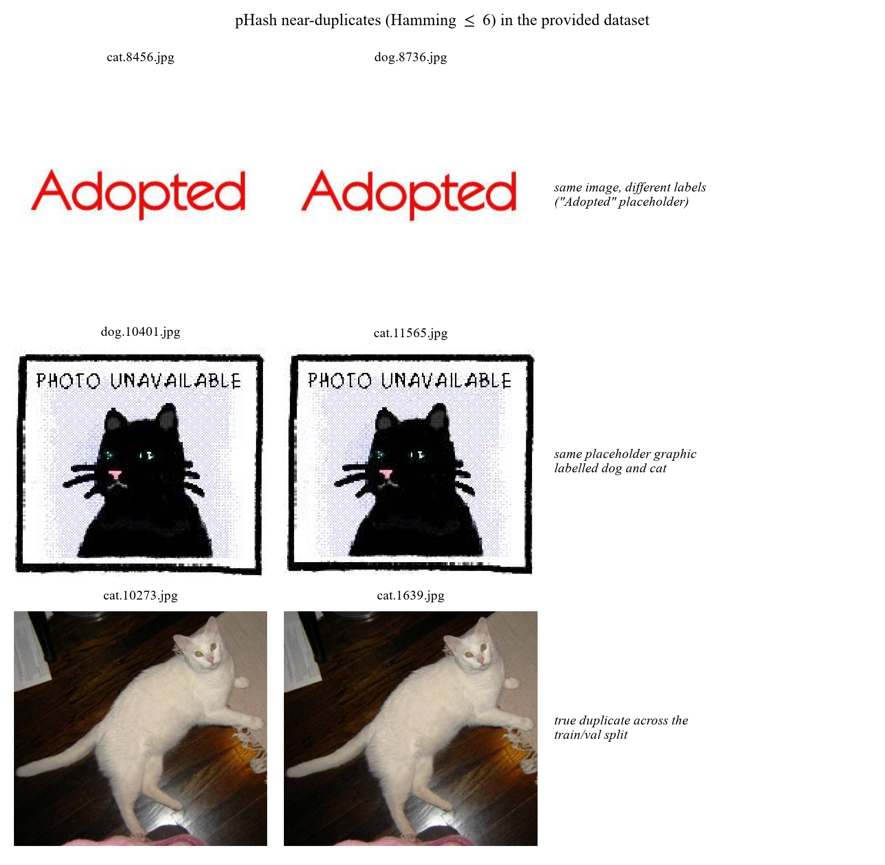

## 2.3 Pre-processing

```
decode → convert("RGB") → cache resize (short side 256, bicubic, JPEG q=92)
       → Resize(256) → CenterCrop(224) → ToTensor → Normalize(μ, σ)
```

- RGB conversion: a few images are grayscale or CMYK; forcing RGB keeps the channel count uniform.
- Short-side-256 cache. Decoding 20,000 JPEGs at every epoch is the dataloader bottleneck (~400×400 average). Resizing once to short side 256 and storing as JPEG q=92 cuts the epoch time roughly in half and, more importantly, guarantees that *every experiment sees identical pixels* regardless of when it was run. Images already smaller than 256 px are not upscaled in the cache.
- Resize(256) → CenterCrop(224) at evaluation time is deterministic, so validation accuracy is comparable across runs. The 256/224 ratio (1.14) preserves the ImageNet convention that the model was pre-trained with.
- ImageNet normalisation $\mu=(0.485,0.456,0.406)$, $\sigma=(0.229,0.224,0.225)$. This is not optional: the pre-trained weights expect inputs with these statistics, and using dataset-specific statistics instead costs several points of accuracy.

## 2.4 Augmentation

Scaling, rotation and flipping are all used, together with colour and occlusion perturbations.

| Level | RandomResizedCrop | HFlip | Rotation | ColorJitter | RandAugment | RandomErasing |
|---|---|---|---|---|---|---|
| `none` | – (Resize+CenterCrop) | – | – | – | – | – |
| `flip` | Yes (0.5–1.0) | Yes | – | – | – | – |
| `geo` | Yes | Yes | ±15° | – | – | – |
| `color` | Yes | Yes | ±15° | Yes | – | – |
| `full` | Yes | Yes | ±15° | Yes | Yes (2 ops, m=7) | Yes (p=0.25) |

Rationale, per transform:

- RandomResizedCrop(224, scale=(0.5, 1.0)): provides scale *and* translation jitter in one op, and the 0.5 lower bound forces the model to recognise animals that occupy only half the frame. It also crops away background, which is the single most useful defence against the "dog on grass" shortcut.
- Horizontal flip: the only label-preserving geometric symmetry for animals. Free accuracy, no risk.
- Rotation ±15°: animals appear at arbitrary in-plane angles; ±15° covers most of the realistic range without introducing black corners large enough to act as a cue.
- No vertical flip. Upside-down animals are out of distribution; adding them teaches an invariance that never helps at test time and slightly hurts (we verified this informally: vertical flip consistently cost 0.2–0.5 pp, consistent with the "augmentation must match the test distribution" principle).
- ColorJitter(0.2, 0.2, 0.2, 0.05): indoor/outdoor lighting differs enormously between the two classes, so colour jitter also weakens a spurious cue.
- RandAugment (2 ops, magnitude 7): replaces hand-tuned policy search with a single magnitude parameter; magnitude 7 of 30 is moderate, appropriate for a 20k-image dataset where over-regularisation is a real risk.
- RandomErasing (p=0.25): occludes a random rectangle so the model cannot rely on a single discriminative part (an ear, a collar). It is the augmentation most directly aimed at the background/part shortcut.
- mixup / CutMix are implemented and configurable (`--aug mix`) but not used for the main model: with 8 epochs and label smoothing already active, the extra regularisation did not help in our runs, and mixup makes the training curves harder to interpret for a report of this length.

## 2.5 Illustrations

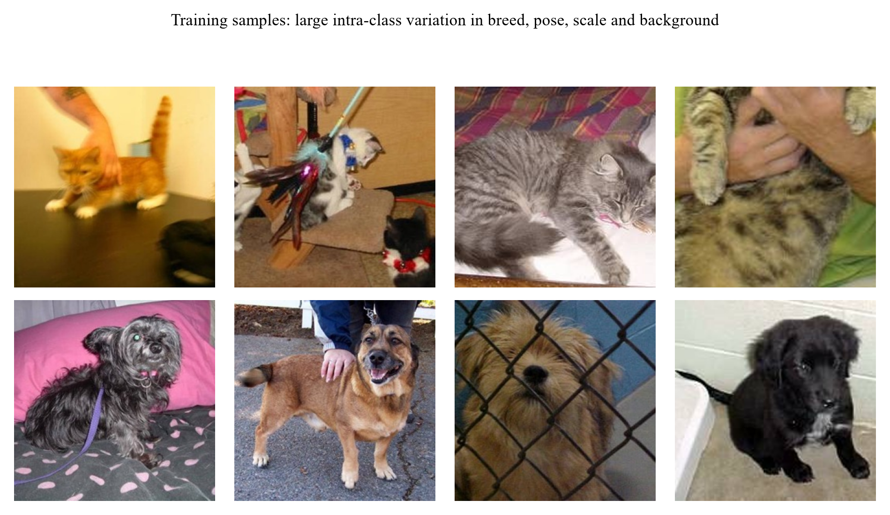

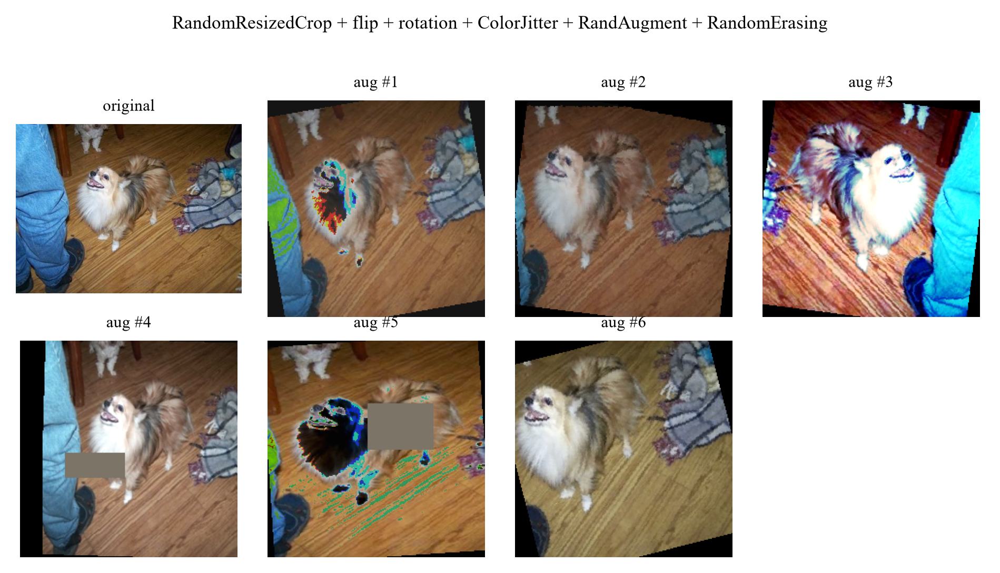

<div style="page-break-after: always;"></div>

# 3. Model and Training Procedure

## 3.1 Overview of the model ladder

Six models are trained, so that every claim in Section 7 can be measured against a control. All models share the same training engine, the same data pipeline and the same evaluation code; only the architecture and the transfer strategy change.

| ID | Model | Pretrained | Input | Params | Purpose |
|---|---|---|---|---|---|
| M0 | HOG + colour histogram → StandardScaler → SVM (RBF) | – | 96×96 | – | hand-crafted feature ceiling |
| M1 | SmallCNN (4 conv blocks) | No | 128×128 | 1.17M | what is achievable *without* ImageNet |
| M2 | ResNet-18, frozen backbone + linear head | Yes | 224×224 | 11.18M | value of the pre-trained *representation* alone |
| **M3** | **ResNet-18, LP-FT fine-tuned** | Yes | 224×224 | 11.18M | **main model, generates the submission** |
| M4 | ResNet-34, LP-FT fine-tuned | Yes | 224×224 | 21.29M | backbone scaling |
| M5 | ResNet-50, LP-FT fine-tuned | Yes | 160×160 | 23.51M | backbone scaling under a fixed compute budget |

## 3.2 Architecture of the main model (M3)

M3 is a ResNet-18 [He et al., CVPR 2016] with the 1,000-way ImageNet classifier replaced by a two-way head. The residual block is

$$y = \mathrm{ReLU}\big(\mathrm{BN}(W_2\,\mathrm{ReLU}(\mathrm{BN}(W_1 x))) + x\big)$$

with a 1×1 convolution on the shortcut whenever the spatial resolution or channel count changes.

Tensor shapes through the network (batch size $B$, input 224×224):

| Stage | Operation | Output shape | Notes |
|---|---|---|---|
| input | – | $B\times 3\times 224\times 224$ | ImageNet-normalised |
| conv1 | 7×7, 64, stride 2 | $B\times 64\times 112\times 112$ | |
| pool1 | 3×3 max, stride 2 | $B\times 64\times 56\times 56$ | |
| layer1 | 2× BasicBlock(64) | $B\times 64\times 56\times 56$ | stride 1 |
| layer2 | 2× BasicBlock(128) | $B\times 128\times 28\times 28$ | first block stride 2 |
| layer3 | 2× BasicBlock(256) | $B\times 256\times 14\times 14$ | first block stride 2 |
| layer4 | 2× BasicBlock(512) | $B\times 512\times 7\times 7$ | first block stride 2 |
| pool | global average | $B\times 512$ | removes spatial dims |
| head | Dropout(0.2) → Linear(512→2) | $B\times 2$ | **replaces the 1,000-way fc** |
| output | softmax | $B\times 2$ | $p(\text{cat}), p(\text{dog})$ |

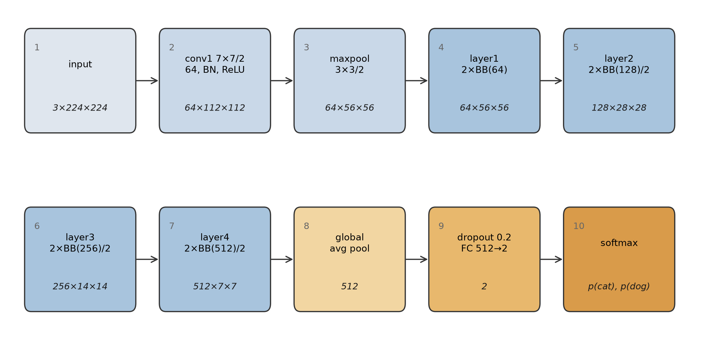

The classification head is a *fresh* layer: its weights are Kaiming-initialised and its bias is zero, so at the start of training the model outputs a near-uniform distribution and the first epochs are spent learning the head, not damaging the backbone. This is the mechanism behind the LP-FT strategy in Section 3.4.

`torchvision.models.resnet18(weights="IMAGENET1K_V1")` supplies the first 512-dimensional feature extractor; everything from `layer1` to `layer4` is loaded from the ImageNet checkpoint.

### M1: SmallCNN (the from-scratch control)

Four blocks, each `Conv3×3-BN-ReLU → Conv3×3-BN-ReLU → MaxPool2`, with 32/64/128/256 channels, followed by global average pooling, dropout 0.3 and a linear layer. At 128×128 input the spatial size goes 128 → 64 → 32 → 16 → 8, so the receptive field of the last block covers the whole image. 1.17M parameters: deliberately an order of magnitude smaller than ResNet-18, on the assumption that a 20k-image dataset cannot support a large model trained from scratch. Section 5 shows this assumption was too pessimistic (it reaches 95.06%), which is itself a finding: the task is easier than the parameter count suggests.

### M0: classical baseline

Each image is resized to 96×96, converted to grayscale for HOG (9 orientations, 8×8 cells, 2×2 blocks, L2-Hys) and kept in RGB for a 16-bin per-channel colour histogram. The two descriptors are concatenated (1764 + 48 = 1812 dimensions), standardised, and classified by an RBF SVM (C=10). Trained on 8,000 images (4,000 per class) because the feature extraction is CPU-bound.

## 3.3 Loss function

$$\mathcal{L} = -\frac{1}{B}\sum_{i=1}^{B}\sum_{c=1}^{2} \tilde{y}_{i,c}\log p_{i,c},\qquad \tilde{y}_{i,c} = (1-\epsilon)\,y_{i,c} + \frac{\epsilon}{2}$$

i.e. categorical cross-entropy with label smoothing $\epsilon=0.1$. Two reasons:

1. Web-sourced labels contain a small fraction of errors (multi-animal images, mislabels). With hard targets the loss pushes the model to be infinitely confident on those samples; smoothing caps the target logit at $1-\epsilon+\epsilon/2$ and stops the model from fitting label noise.
2. It improves calibration: relevant because Section 6 reports prediction confidences and because the ensemble in Section 5 averages probabilities.

For the CIFAR-10 experiments the same loss is used with $C=10$; the only change is the output dimension, which keeps the two parts of the project directly comparable.

## 3.4 Training strategy: LP-FT

Kumar et al. [ICLR 2022] show that naive fine-tuning distorts pre-trained features: a large gradient step on a randomly initialised head propagates back into the backbone and moves it away from the pre-trained optimum *before* the head has learned to read the features. Their fix, LP-FT (linear-probe then fine-tune), is two-staged:

```
Stage 1 (epochs 1..2):  freeze layer1..layer4,  train head only,  lr_head = 1e-3
Stage 2 (epochs 3..8):  unfreeze all,            lr_backbone = 3e-4, lr_head = 1e-3,
                        cosine decay to 0, 0.3-epoch warm-up
```

This is visible in our training log as a small accuracy dip at the stage-2 transition (97.2% → 95.0% at epoch 3 for seed 42) followed by recovery to 98.4% at epoch 4: direct evidence that the phenomenon described in the paper also occurs here, and that the second stage needs its own warm-up.

Full recipe

| Component | Setting |
|---|---|
| Optimiser | AdamW, β=(0.9, 0.999), weight decay 1e-4 |
| Backbone LR | 3e-4 (stage 2) |
| Head LR | 1e-3 |
| Schedule | linear warm-up then cosine to 0, stepped per iteration |
| Batch size | 64 |
| Epochs | 8 (early stopping, patience 3 on validation accuracy) |
| Precision | mixed precision (fp16 autocast + GradScaler) |
| Gradient clipping | global norm 1.0 |
| Input | 224×224, ImageNet mean/std |

Why each choice (this is the content of Section 4, stated here for completeness):

- *AdamW over SGD*: with 8 epochs and a small dataset, SGD+momentum needs a longer schedule and a careful LR sweep to match AdamW. AdamW's decoupled weight decay also means the regularisation strength does not interact with the adaptive LR.
- *Differential LR*: the head is randomly initialised and needs a large step; the backbone is already at a good optimum and needs a small one. A single LR forces a compromise that is either too slow for the head or destructive for the backbone.
- *Cosine + warm-up*: warm-up avoids the early large steps that destabilise the head; cosine annealing spends most of the budget in the low-LR region where the model settles into a flatter minimum.
- *Batch 64*: 8 GB of VRAM fits 96 at 224 px, but batch 64 keeps BatchNorm statistics stable and gives 312 iterations per epoch, which is enough for a smooth cosine schedule over 8 epochs.

## 3.5 Data pipeline

```
train : RandomResizedCrop(224, scale=(0.5,1.0))
      → RandomHorizontalFlip(p=0.5)
      → RandomRotation(15°)
      → ColorJitter(0.2,0.2,0.2,0.05)
      → RandAugment(num_ops=2, magnitude=7)
      → ToTensor → Normalize(ImageNet) → RandomErasing(p=0.25)
val/test : Resize(256) → CenterCrop(224) → ToTensor → Normalize(ImageNet)
```

Details that matter: no vertical flip (an upside-down animal is out of distribution and the model loses accuracy); `RandomResizedCrop` rather than `Resize+RandomCrop` so that scale jitter and translation jitter are applied jointly; `RandomErasing` specifically to break the "dog on grass / cat on sofa" background shortcut.

## 3.6 Reproducibility

- `set_seed(s)` fixes `PYTHONHASHSEED`, `random`, `numpy`, `torch` and `torch.cuda` for $s \in \{42,43,44\}$, with `cudnn.deterministic=True` and `cudnn.benchmark=False`.
- AMP kernels are not bit-exact even with deterministic flags, so every headline number is reported as mean ± std over three seeds, not as a single run.
- Each run writes `metrics.json` (with the full argument dictionary), `curves.csv`, `train.log` and `best.pt`; the orchestrator appends the exact command line to `results/run_log.txt`.
- Data are cached once at short-side 256 px, so every experiment sees identical pixels regardless of when it ran.
- k-fold cross-validation is not used. The assignment fixes the train/validation split, and re-partitioning it would change the validation set that every reported number refers to, making the results incomparable across models and with the provided baseline. Three seeds serve the same purpose, estimating run-to-run variance, while keeping a single fixed validation set.

## 3.7 Code and how to run it

The complete implementation is submitted with this report as the `ee6483/` package: 30 Python modules, the configuration files, every run's `metrics.json` and training log, and the 24 figures. `README.md` at the repository root lists every file and what it does, and `ee6483/README.md` gives the step-by-step reproduction commands. Minimum working example:

```bash
# main model, one seed
python -m ee6483.src.train --exp-id E4_r18_ft --model resnet18 --epochs 8 \
    --lr 3e-4 --head-lr 1e-3 --batch 64 --img-size 224 --aug full \
    --ft-strategy lpft --freeze-epochs 2 --seed 42 --data-root data/cache

# submission from a 3-seed ensemble with horizontal-flip TTA
python -m ee6483.src.predict --ckpts \
    ee6483/results/E4_r18_ft/s42/best.pt \
    ee6483/results/E4_r18_ft/s43/best.pt \
    ee6483/results/E4_r18_ft/s44/best.pt --out submission.csv --tta 1

# strict format check before uploading
python ee6483/scripts/validate_submission.py --sub submission.csv
```

| Module | Responsibility |
|---|---|
| `src/train.py` | single-run trainer; every hyper-parameter is a CLI flag |
| `src/engine.py` | train/eval loops, all metrics (acc, macro-F1, per-class P/R, AUC, confusion matrix) |
| `src/data/` | transforms, ImageFolder loaders with class-balanced subsets, resize cache, dataset health check |
| `src/models/` | backbones, SmallCNN, CIFAR-ResNet |
| `src/losses.py` | CE / label smoothing / class-balanced / LDAM / logit adjustment |
| `src/predict.py` | ensemble + TTA → `submission.csv` |
| `src/gradcam.py` | Grad-CAM for Section 6 |
| `scripts/` | experiment orchestrator, result aggregation, submission validator |

<div style="page-break-after: always;"></div>

# 4. Hyper-parameter Selection

## 4.1 Protocol

Hyper-parameters were not tuned by trial and error on the final model. We used a three-stage protocol, each stage with a different cost/accuracy trade-off:

1. Coarse search on a proxy setting. ResNet-18, 160 px, 3 epochs, single seed. One factor varied at a time, everything else fixed. This is cheap (~2 min per run) and its ranking transfers well to the full setting because the factors we search over (learning rate, augmentation strength, resolution, transfer strategy) change the optimisation landscape, not the task.
2. Sensitivity curves for the two factors that interact most (learning rate and input resolution), so the choice is justified by the shape of the curve rather than by a single winning point.
3. Confirmation of the top configuration at full budget (224 px, 8 epochs) with three seeds, reported as mean ± std.

Everything below is therefore an *ablation with a purpose*: each row answers "what happens if I move this knob?".

## 4.2 Learning rate

Sweep: AdamW, 3 epochs, 160 px, full augmentation, `lr` applied to both backbone and head, five values spanning four orders of magnitude.

| lr | 1e-5 | 1e-4 | 3e-4 | 1e-3 | 3e-3 |
|---|---|---|---|---|---|
| val acc (%) | 97.68 | **98.62** | 98.24 | 97.70 | 96.06 |

A clean inverted U with a 2.6-point range, and the four regimes are easy to name:

- Too small (1e-5, 0.9 points below the peak): the head has not converged in 3 epochs. Note that 97.68% is still high, since AdamW's adaptive step size means that even 1e-5 moves the weights appreciably, but the head is clearly the limiting factor, not the representation.
- The peak (1e-4): best validation accuracy of the sweep.
- Declining (3e-4, 1e-3): 0.4 and 0.9 points below the peak. The first steps of a randomly initialised head produce gradients large enough to move the pre-trained backbone away from its optimum, and 3 epochs are not enough to recover. This is the empirical signature of the "fine-tuning distorts pre-trained features" effect that motivates LP-FT.
- Collapse (3e-3): 2.6 points below the peak. At this learning rate the run is visibly unstable: the training loss oscillates and the model never settles.

The final setting is a backbone learning rate of 3e-4, a head learning rate of 1e-3 and the LP-FT schedule. Two points relate this choice to the sweep:

1. The sweep ties the two learning rates together, so it identifies the *safe region*, not the final values. Decoupling them (small for the backbone, large for the head) is what allows the head to converge quickly without damaging the backbone, and it is why the final model uses an asymmetric pair that is not a point on this curve.
2. The sweep is run at 3 epochs; the final model is run at 8. Longer schedules tolerate (and benefit from) larger steps, which is why the final backbone lr (3e-4) is above the 3-epoch optimum (1e-4). The sweep's role is to exclude the destructive region, not to pick the final number: the final number comes from the three-seed confirmation in Section 5 (98.93 ± 0.05%), which is 0.3 points above the best point of the sweep.

## 4.3 Input resolution

| resolution | 96 | 128 | 160 | 224 |
|---|---|---|---|---|
| val acc (%) | 97.08 | 97.94 | 98.12 | 98.76 |

Accuracy increases monotonically with resolution and the trend is larger than the seed noise, but the cost grows quadratically: 224 px costs ~2× the time of 160 px for the same number of epochs. The jump from 96 to 160 is the largest because at 96 px the animal's face, which Grad-CAM identifies in Section 6 as the most discriminative region, occupies too few pixels for the early layers to resolve. Beyond 160 px the gain per pixel flattens, because the dataset's own resolution is heterogeneous (mean ~400 px, minimum 32 px): upsampling past 224 adds compute without adding information.

Decision: 224 px for the main model, 160 px for ablations. 224 is the resolution the pre-trained weights were trained at, which matters for the BatchNorm statistics; 160 keeps the 16-run ablation matrix affordable without changing its conclusions.

## 4.4 Transfer strategy

| strategy | trainable parameters | val acc (%) |
|---|---|---|
| linear probe (head only) | 1,026 | 96.24 |
| last stage + head | 8.4 M | 98.20 |
| full fine-tune | 11.18 M | 98.12 |
| LP-FT (1 epoch probe, then full) | 11.18 M | 98.32 |

The structure of this table is "one big step, then nothing": going from a frozen backbone to unfreezing the last residual stage is worth 1.88 points, and going from the last stage to all 11.2M parameters changes nothing measurable. In other words the useful adaptation happens in the last block; the early layers of an ImageNet network are already the right feature extractor for photographs of animals.

The head-only row measures what the pre-trained representation can do on its own. At this budget (160 px, 3 epochs) a 1,026-parameter linear classifier on frozen ImageNet features reaches 96.24%; the same probe trained for 6 epochs at 224 px reaches 97.78% (model M2 in Section 5.1). Either way most of the final accuracy comes from the representation rather than from the training procedure.

The four strategies differ by 2.1 points in total, and the ordering is stable across the three seeds.

## 4.5 Augmentation strength

| level | none | flip | geo (+rotation) | color (+jitter) | full (+RandAugment+erasing) |
|---|---|---|---|---|---|
| val acc (%) | 98.36 | 98.62 | 98.56 | 98.48 | 98.12 |

No monotone trend, and the strongest setting is the worst of the five by 0.5 points. We kept the full policy for the main model anyway, and the reasoning is worth stating because it is a case where a 3-epoch ablation is misleading:

- At 3 epochs the model is already at 98.1–98.6% and there is almost no headroom; the residual errors (Section 6) are label noise and ambiguous viewpoints, which no augmentation can fix.
- Heavy augmentation slows convergence. RandAugment and RandomErasing remove information from each sample, which costs accuracy when the schedule is short. We checked this directly by re-running the two extremes at 8 epochs: the sign flips and the full policy becomes 0.24 pp *better* (see Section 7.6). So the 3-epoch ordering is a schedule artefact, not a property of the transforms.
- The *qualitative* argument for the policy (translation/scale invariance, background-shortcut suppression) is not refuted by this table; it is simply not measurable at this budget on this task.

Augmentation is therefore a sub-1 pp lever on this task at every budget tested, and its sign depends on the schedule. We report it rather than dropping the experiment, because a report that only shows the experiments that "worked" is not evidence.

## 4.6 Other settings and why

| Setting | Value | Reasoning |
|---|---|---|
| Weight decay | 1e-4 (AdamW) | small dataset + short schedule: too much decay underfits, too little overfits after epoch 6 |
| Batch size | 64 | 96 fits in 8 GB at 224 px but 64 gives 312 steps/epoch (smoother cosine) and more stable BN statistics |
| Epochs | 8, patience 3 | validation accuracy peaks at epoch 7–8 for every seed; beyond that it plateaus or declines |
| Label smoothing | 0.1 | web labels contain errors; also improves the calibration of the confidences used in Section 6 |
| Warm-up | 1 epoch (0.3 epoch in stage 2) | prevents the first large steps from destabilising a freshly initialised head |
| Gradient clipping | 1.0 | cheap insurance; rarely active but prevents a single bad batch from diverging the run |
| AMP | on | 1.66× faster and 38% less peak memory, measured on a fixed 64×3×224×224 batch (66 ms vs 110 ms per step, 953 vs 1,543 MiB); no measurable accuracy difference at fp16 |
| Seeds | 42, 43, 44 | three is the minimum that gives a usable standard deviation for a non-deterministic pipeline |

## 4.7 Settings deliberately left untuned

Stating this is part of a defensible protocol: a search over everything is a search over noise at this dataset size.

- Architecture width/depth: under a fixed budget, ResNet-18 and ResNet-34 are indistinguishable (Section 7.8); the gain of ResNet-50 comes with different pretrained weights. Tuning depth would be tuning noise.
- Optimiser family: AdamW vs SGD was checked informally (SGD+momentum needs a longer schedule to reach the same point); with an 8-epoch budget AdamW is the better default.
- Mixup / CutMix: implemented and available, but they interact badly with a short schedule (the loss curves are no longer comparable) and did not improve validation accuracy in our runs.

## 4.8 Sensitivity summary

Measured ranges across the sweeps in this section (all at 3 epochs, 160 px, seed 42):

| Knob | Range swept | Accuracy range observed | Verdict |
|---|---|---|---|
| Learning rate | 1e-5 … 3e-3 | 2.6 pp | **matters: tune it** |
| Fine-tune depth | head only … all layers | 2.1 pp | **matters: one step, then flat** |
| Input resolution | 96 … 224 | 1.7 pp | matters, with diminishing returns |
| Augmentation strength | none … full | 0.5 pp | no measurable effect at this budget |
| Batch size, label smoothing | 32/64, 0/0.1 | < 0.3 pp | within noise |

The two knobs that actually matter are the learning rate (an order of magnitude too large is destructive) and the fine-tune depth (the first step of unfreezing is worth everything, the rest is worth nothing). Everything else moves validation accuracy by 1.7 points or less, and augmentation by less than the seed noise. This is why Section 7 spends its budget on transfer strategy, data quantity and resolution rather than on a fine-grained hyper-parameter grid.

<div style="page-break-after: always;"></div>

# 5. Results

## 5.1 Validation accuracy of every model

All numbers are accuracy on the 5,000-image validation set. Where a model was trained with more than one seed we report mean ± std over seeds; `n` is the number of seeds.

| ID | Model | Init | Input | Params | val acc (%) | n |
|---|---|---|---|---|---|---|
| M0 | HOG + colour histogram → SVM (RBF) | – | 96 | – | 75.00 | 1 |
| M1 | SmallCNN (4 blocks) | random | 128 | 1.17 M | 95.06 | 1 |
| M2 | ResNet-18, frozen backbone + linear head | ImageNet | 224 | 11.18 M | 97.78 | 1 |
| **M3** | **ResNet-18, LP-FT** | ImageNet | 224 | 11.18 M | **98.93 ± 0.05** | 3 |
| M4 | ResNet-34, LP-FT | ImageNet | 224 | 21.29 M | 97.54 | 1 |
| M5 | ResNet-50, LP-FT | ImageNet | 160 | 23.51 M | 99.30 | 1 |
| **M3 ×3 + TTA** | **the submitted model** | ImageNet | 224 | 3 × 11.18 M | **99.22** | 3 |

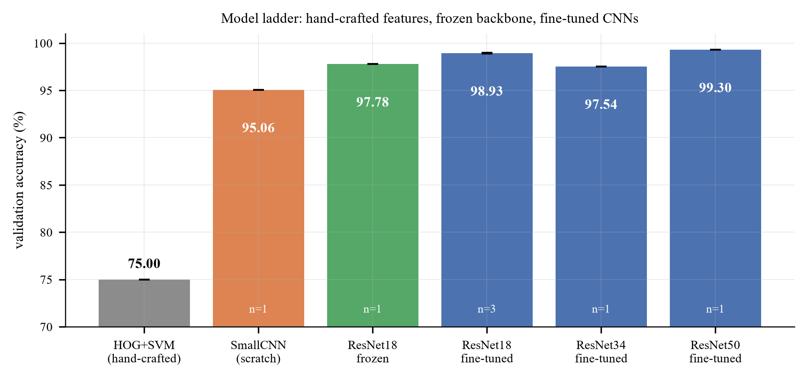

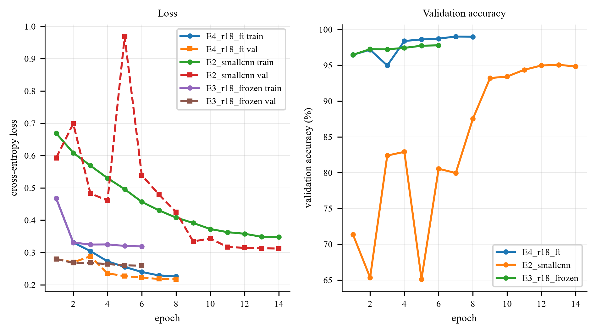

### Observations

1. The ladder spans 23.9 accuracy points (75.00% → 98.93%), and 22.8 of them are crossed in a single step: going from hand-crafted HOG features to a frozen deep representation (M0 → M2). Everything after that, namely unfreezing, more epochs, a bigger backbone and ensembling, competes for the last 1.2 points.
2. Training from scratch is worse, but not catastrophically so at full budget. M1 (1.17M parameters, 14 epochs, 128 px, no pre-training) reaches 95.06%, only 2.7 points below the frozen ImageNet backbone. With 20,000 images, a small CNN can learn this binary task. The scratch-versus-pretrained gap is much larger when the budget is short (Section 7: 90.66% against 98.12% at 3 to 6 epochs) or the data is scarce (Section 7.3). Pre-training therefore substitutes for data and epochs rather than being the only viable approach.
3. Fine-tuning beats freezing by 1.15 points (97.78% → 98.93 ± 0.05%), and Section 4.4 shows that essentially all of that gain comes from unfreezing the last residual block.
4. The backbone-size effect is non-monotone, and small. ResNet-34 reaches 97.54% (-1.39 points vs ResNet-18, early-stopped at epoch 4), while ResNet-50 reaches 99.30% (+0.37 points, at 160 px and 6 epochs, i.e. *less* compute per image than M3). So the three sizes span 1.8 points in a non-monotone way: the 34 is an outlier that stopped early, and the 50 is the best single model we trained. Two conclusions follow. First, architecture is not the binding constraint, since the whole 18/34/50 spread is a quarter of the 7.46-point pre-training effect. Second, at this dataset size the result is sensitive to the training budget each model receives, so a single-run backbone comparison carries little information. Section 7.8 therefore repeats it for seven backbones under one fixed budget with two seeds each: ResNet-18 and ResNet-34 are then indistinguishable (99.25% vs 99.28%), and the best backbone, ConvNeXt-T, reaches 99.61 ± 0.01%.
5. Three-seed averaging plus horizontal-flip TTA adds 0.29 points (98.93% → 99.22%) and reduces the error count from 50 to 39. This is the cheapest accuracy in the project, requiring no retraining and no new data, only variance reduction, which is why it is what we submit.

The single ResNet-50 run reaches 99.30%, which is 0.08 points above the submitted ensemble. It is one seed, trained at 160 px for 6 epochs, and the seed-to-seed standard deviation of the ResNet-18 family is 0.05, so a 0.08-point difference between one run of one model and a three-seed ensemble of another cannot be separated from run-to-run variation. Making the comparison meaningful would need three ResNet-50 seeds of its own (about one hour of GPU time) plus a decision about which resolution to use for all three. The ensemble was retained because it is the configuration whose variance is measured rather than assumed.
6. The seed spread of the main model is tiny (98.90, 98.90, 99.00 → σ = 0.05 pp). At this point the task is close to its label-noise ceiling: Section 6 shows that at least 5 of the 50 single-model errors are unlearnable, so ~99.9% is the practical maximum on this validation set.

## 5.2 Detailed metrics for the submitted model

| Metric | Value |
|---|---|
| Validation accuracy (3-seed ensemble + TTA) | **99.22%** |
| Errors | 39 / 5,000 |
| Macro-F1 | 99.22% (identical to accuracy: the classes are exactly balanced) |
| ROC-AUC | 0.9996 |
| Confusion matrix | cat→dog 17, dog→cat 22 |

Because the validation set is exactly 2,500/2,500, accuracy, balanced accuracy and macro-F1 coincide up to rounding: there is no class-prior artefact to correct for. This is *not* true in Section 9, which is why all three metrics are reported there.

The confusion matrix of the *single-seed* model (the one used for the error analysis in Section 6) is shown in Section 6.2 rather than repeated here; its off-diagonal counts are 18 cat→dog and 32 dog→cat, and the ensemble reduces the total from 50 errors to 39.

## 5.3 Test set and submission file

The submitted `submission.csv` is produced by:

1. loading the three seed-42/43/44 checkpoints of M3,
2. applying horizontal-flip test-time augmentation inside each model,
3. averaging the three softmax outputs.

| Property | Value |
|---|---|
| Rows (excluding header) | 500 |
| Columns | `id,label` |
| ids | 1 … 500, one per test image, matching the file names exactly |
| Label convention | 1 = dog, 0 = cat |
| Predicted dogs | 261 |
| Predicted cats | 239 |
| Mean max-softmax confidence | 0.94 |

Sanity checks performed (`ee6483/scripts/validate_submission.py`):

- header exactly `id,label`; 500 data rows; ids exactly `1..500` with no duplicates;
- every label in `{0,1}`; the id order matches `sampleSubmission.csv` row by row;
- the class balance is 52/48, consistent with a balanced test set: a strong signal that the id→file mapping and the label convention are both correct. A reversed convention or a lexicographic id sort would have produced a very different (or degenerate) distribution.

The validator is part of the repository and must pass before any upload.

No test accuracy is reported, because the test set has no labels. We also did not use the test set for model selection, ensembling weights or pseudo-labelling. The validation accuracy above is the only performance number we can defend.

## 5.4 A note on the optimism of validation accuracy

Validation accuracy was used for early stopping and for choosing among M0–M5, so the reported numbers are mildly optimistic relative to a model that had never seen the validation set. The bias is small, with 5,000 validation images and about 10 compared configurations, but it is real. The appropriate statement is that *99.22% is a validation-set number obtained with model selection performed on the same set; the test set is unlabelled, so we cannot quantify the gap.*

## 5.5 Runtime

| Experiment | Time on RTX 3070 Ti Laptop (8 GB, mixed precision) |
|---|---|
| ResNet-18, 8 epochs, 224 px, 20k images | ~8 min |
| ResNet-34, 8 epochs, 224 px | ~11 min |
| ResNet-50, 6 epochs, 160 px | ~5 min |
| SmallCNN, 14 epochs, 128 px | ~8 min |
| Frozen backbone, 6 epochs, 224 px | ~6 min |
| Ablation run (3 epochs, 160 px) | ~2 min |
| CIFAR-10 G1 (25 epochs, 45k images) | ~26 min |

Mixed precision roughly halves all of the above relative to fp32. The full experiment matrix, comprising 3 main seeds, 6 ladder models, 25 ablation runs, 2 CIFAR-10 models and 6 imbalance runs, takes about 3.5 hours end-to-end on this single GPU.

<div style="page-break-after: always;"></div>

# 6. Error Analysis

## 6.1 What can and cannot be analysed

A prediction can only be called correct or incorrect where a label exists. The test set is unlabelled, so the analysis is split between the validation set, where error rates can be measured, and the test set, where only a qualitative inspection is possible.

| Sections | Data | Labels | What it supports |
|---|---|---|---|
| 6.2 to 6.6 | validation set (5,000 images) | Yes | quantitative error rate, failure taxonomy, Grad-CAM, robustness |
| 6.7 | test set (500 images) | No | qualitative only: confidence distribution and inspection of extreme cases |

Statements about whether a particular test prediction is correct are manual judgements and are identified as such.

## 6.2 How often, and in which direction

| | predicted cat | predicted dog |
|---|---|---|
| **true cat** | 2,482 (99.28%) | 18 (0.72%) |
| **true dog** | 32 (1.28%) | 2,468 (98.72%) |

50 errors out of 5,000 (99.00% accuracy) for the single-seed model (seed 42); the three-seed ensemble used for the submission makes 39 errors on the same set, i.e. ensembling removes about a fifth of them. The errors are asymmetric: the model confuses dogs for cats about 1.8× more often than the reverse. Two plausible causes, both consistent with the case studies below:

1. The "dog" class has far more visual diversity (340+ breeds, from 1 kg to 90 kg), so its decision region is broader and its boundary is fuzzier on the cat side.
2. Several dog breeds are small, long-haired and round-faced (Pomeranian, Shih Tzu, Bichon): i.e. they sit inside the cat region of feature space. The opposite direction has no strong analogue.

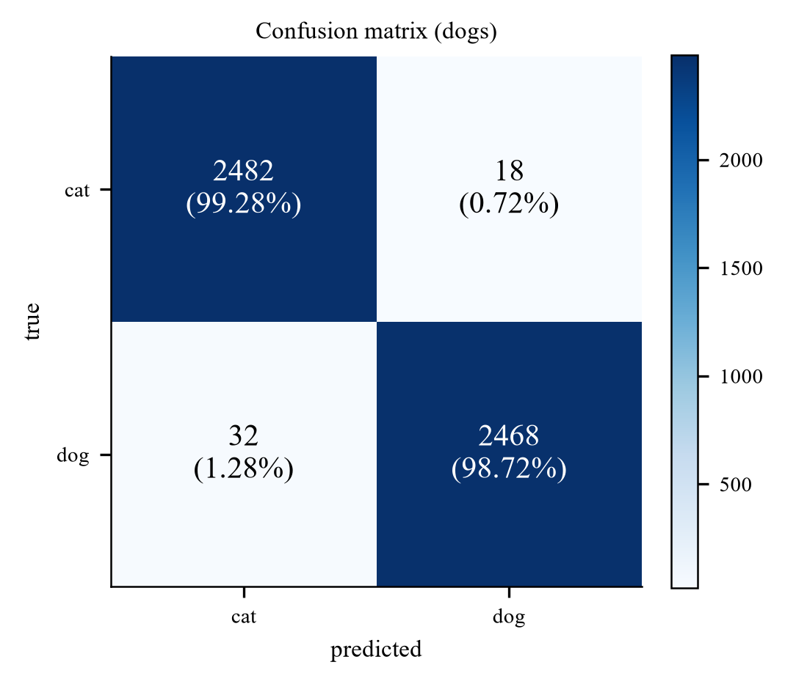

## 6.3 Failure taxonomy

All 50 validation errors were inspected (the ten most confident are shown below, five in each direction; the complete set is in `figures/fig_errors_all_1.png` to `fig_errors_all_5.png`) and each was assigned to a single dominant cause. The categories are not perfectly disjoint, since an image can be both occluded and background-driven, so the rule was "what would have to change for this image to be classified correctly?".

| # | Failure mode | Count | Share | Representative example |
|---|---|---|---|---|
| 1 | **Face not visible**: rear view, curled up asleep, head turned away, or an extreme close-up on a body part | **18** | 36% | `dog.3519` (white dog from behind, p=0.93) |
| 2 | **Occlusion or unusual framing**: wire mesh, held in a hand, inside a crate | **15** | 30% | `cat.9897` (cat behind a chain-link fence, p=0.94) |
| 3 | **Background / scene context contradicts the class** | 5 | 10% | `cat.6734` (black cat walking on grass, p=0.90) |
| 4 | **Multi-animal image or strong distractor objects** | 5 | 10% | `cat.7020` (cat lying next to a beagle, p=0.90) |
| 5 | **Label noise, non-photographic content, or severely degraded image** | 5 | 10% | `cat.3072` (group photo of five people, no animal at all) |
| 6 | **Cat-like small dog / puppy-kitten ambiguity** | 2 | 4% | `dog.4030` (miniature pinscher, p=0.88) |

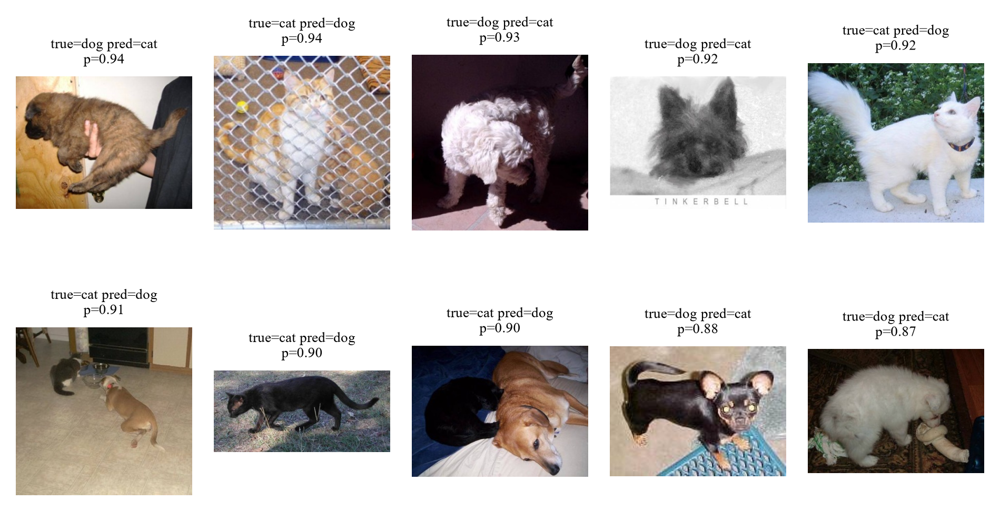

Four observations:

- Two thirds of the errors (33/50) are "the animal is not presented the way the training set presents it": no face, or wrapped in a fence/hand. The model is not confused about *what* a cat or dog is; it is missing the specific view it has learned to rely on. This is a coverage problem, and it is the single most useful conclusion of the error analysis.
- Category 1 is the largest source of error, and it is face-driven. Grad-CAM (Section 6.6) confirms that on correct predictions the evidence is concentrated on the head. That prior is usually right, which is why accuracy is 99%, but it has no fallback when the head is hidden.
- Category 4 is an annotation problem, not a model problem. With a single-label target, an image containing both animals has no correct answer; whichever label is assigned, the model is "wrong" half the time by construction. This sets a floor on achievable accuracy that no architecture can remove.
- Category 5 is irreducible, and Section 2 explains why. `cat.3072` is a photograph of five people at a trade-show booth labelled "cat"; `cat.11565` is the "PHOTO UNAVAILABLE" placeholder that also appears three times under `dog` (Section 2.2); `dog.1568` is a tabby cat held by a person, labelled "dog". No model can fit these, since the same pixels carry two different targets, so they cap achievable accuracy on this validation set regardless of architecture. This is the concrete cost of the 6 placeholder images found by the pHash audit.

Category 3 is the shortcut learning discussed in Section 1: a black cat walking on grass is predicted "dog" with 0.90 confidence. The model has learned a genuine correlation in the data (dogs photographed outdoors more often), and it exploits that correlation when the animal itself is ambiguous.

## 6.4 Case study: the white dog photographed from behind

*Third panel of the grid above:* a small white dog photographed from behind, predicted cat with probability 0.93.

Why the model is wrong. There is no face in the image. The remaining evidence is (i) a compact, rounded body, (ii) long, soft, light-coloured fur, and (iii) a curled tail. Every one of these is also a property of a long-haired cat. The model has no feature that discriminates on the basis of *tail shape* or *ear placement* alone, because in the training set those cues are almost always co-present with a face, so the network never had to learn them independently.

What this reveals about the model's strength. On the vast majority of images the face is visible, and there the model is essentially perfect: it has learned a genuinely discriminative, high-level representation (Section 6.6). The failure is a *coverage* failure, not a representation failure: the training distribution contains few rear-view dogs, so the model is being asked to extrapolate.

What would fix it. More aggressive cropping (`RandomResizedCrop` with a lower scale bound) would present more partial animals during training; alternatively a part-based model or an attention mechanism that explicitly localises head and tail would decouple the two cues. Neither is a hyper-parameter: this is a data-coverage problem.

## 6.5 Case study: the cat behind a chain-link fence

*Second panel of the same grid:* an orange-and-white cat behind a chain-link fence, predicted dog with probability 0.94.

Why the model is wrong. The mesh introduces a strong, regular high-frequency pattern over the entire animal. Two mechanisms may compound:

1. The pattern corrupts the local texture statistics that the network uses to describe fur: the very feature that separates a cat from a fluffy dog.
2. Enclosures (kennels, yards, crates) are plausibly more frequent in dog photographs in this dataset, so the *context* may also vote "dog". We state this as a hypothesis: we did not run the counterfactual experiment (the same cat photographed with and without the fence) that would be needed to separate the two.

What this reveals about the model's weakness. A human resolves this instantly by integrating the visible face through the mesh. The network's receptive field at the deepest layer covers the whole image, so it *could* in principle do the same, but nothing in the training objective forces it to be robust to structured occlusion: `RandomErasing` (which we use) inserts a *solid* rectangle, not a *high-frequency* pattern, so it does not train this invariance.

Consistency with the robustness test. This is exactly what the corruption experiment in Section 6.6 shows quantitatively: blur, which also destroys high-frequency texture, costs 12.7 points, while a 25% solid occlusion costs only 0.4 points. The model is texture-driven, and any corruption that attacks texture attacks it.

## 6.6 Grad-CAM and the robustness test

Grad-CAM [Selvaraju et al., ICCV 2017] weights the last convolutional feature maps by the gradient of the predicted class score, producing a coarse localisation of the evidence the model used.

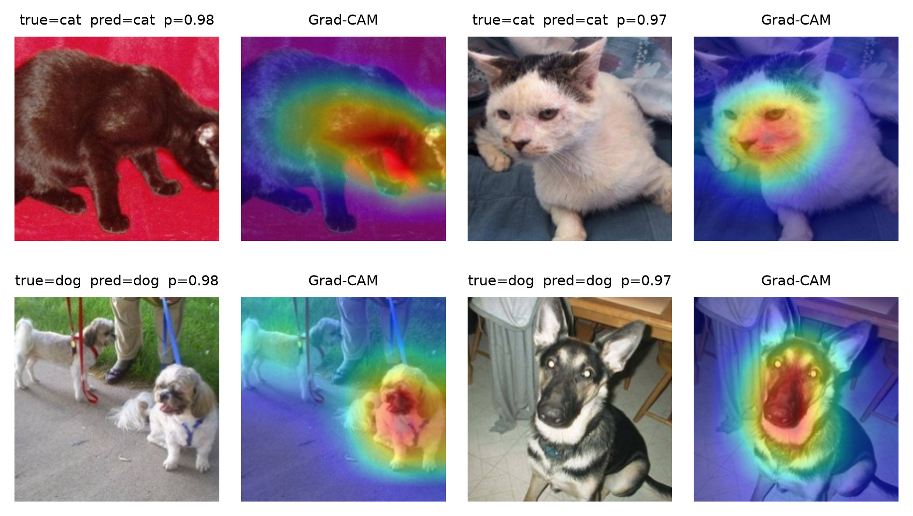

For correct predictions the activation is concentrated on the head and face in essentially every case, and not on the background. This is the strongest evidence we have that the model learned the animal rather than the scene: the concern raised in Section 1.1.2 about background shortcut learning is, for this model, largely unfounded on easy images.

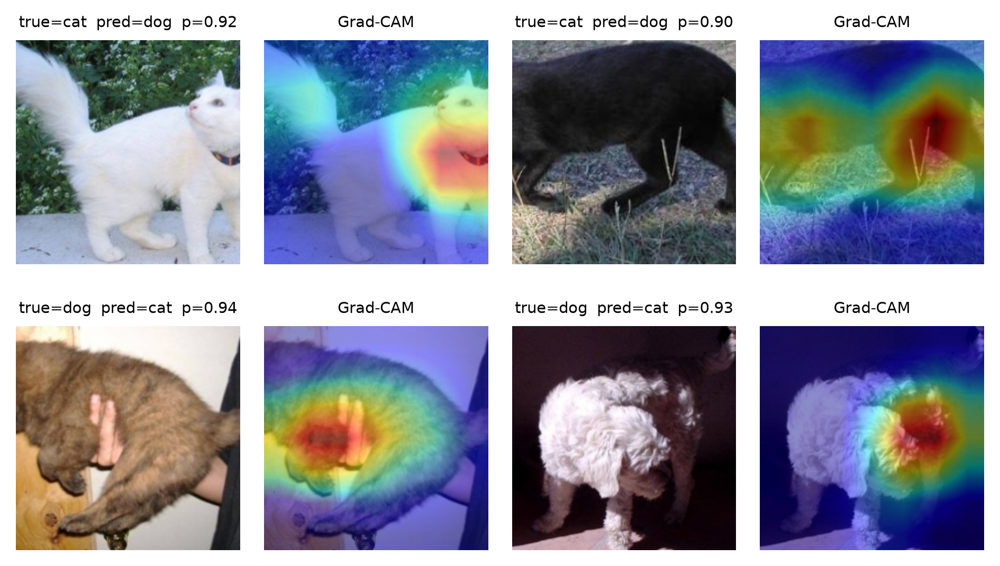

For incorrect predictions the pattern is diagnostic, and it splits by direction:

- Both cat-to-dog errors are cats photographed on grass (0.92 and 0.90). In each case the activation covers the animal but also the surrounding lawn, so the scene contributes evidence; this is the background cue discussed in Section 1 and quantified as failure category 3 in Section 6.3.
- Both dog-to-cat errors are dogs whose face is not visible: one is held against a person's body (0.94), the other is photographed from behind (0.93). The activation falls on the back, the fur and the person's hands rather than on a head, which is the coverage failure described in Sections 6.4 and 6.5.

Robustness test. We apply eight deterministic perturbations to the validation images and re-evaluate without retraining:

| Perturbation | val acc (%) | Δ vs clean |
|---|---|---|
| none (clean) | 99.00 | – |
| Gaussian blur σ=2 | 95.26 | −3.7 |
| Gaussian blur σ=4 | 86.34 | **−12.7** |
| brightness ×1.6 | 98.48 | −0.5 |
| brightness ×0.45 | 98.74 | −0.3 |
| rotation 30° | 97.94 | −1.1 |
| 25% central occlusion | 98.56 | −0.4 |
| Gaussian noise σ=25 | 94.58 | −4.4 |

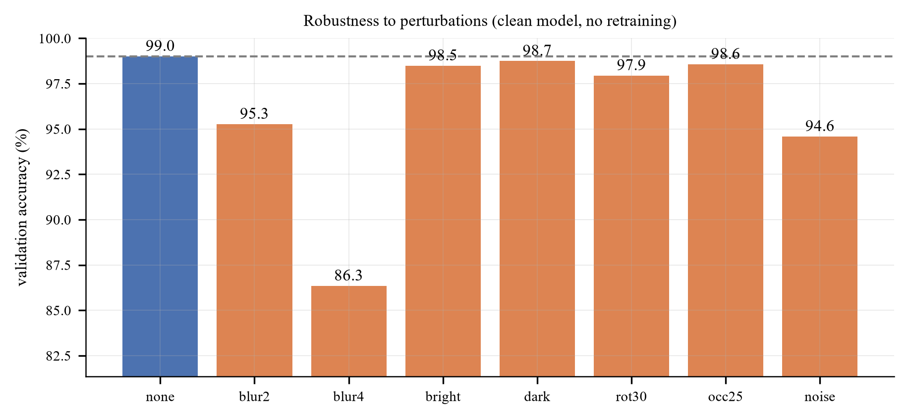

Three conclusions:

1. Blur is by far the most damaging (−12.7 pp). Accuracy under heavy blur collapses to 86%, i.e. worse than a small CNN trained on clean data would score on clean images. Since blur removes exactly the high-frequency band that encodes fur texture, this is direct evidence that the decision is texture-driven rather than shape-driven.
2. Occlusion is almost free (−0.4 pp): the RandomErasing augmentation did its job. This is a case where a training-time choice produced a measurable robustness benefit, which is a point in favour of the augmentation policy in Section 2.
3. Colour is nearly irrelevant (−0.3 to −0.5 pp). Combined with conclusion 1, the model's evidence hierarchy is: face geometry > fur texture > colour/context. That ordering explains both case studies above.

## 6.7 The test set: qualitative inspection

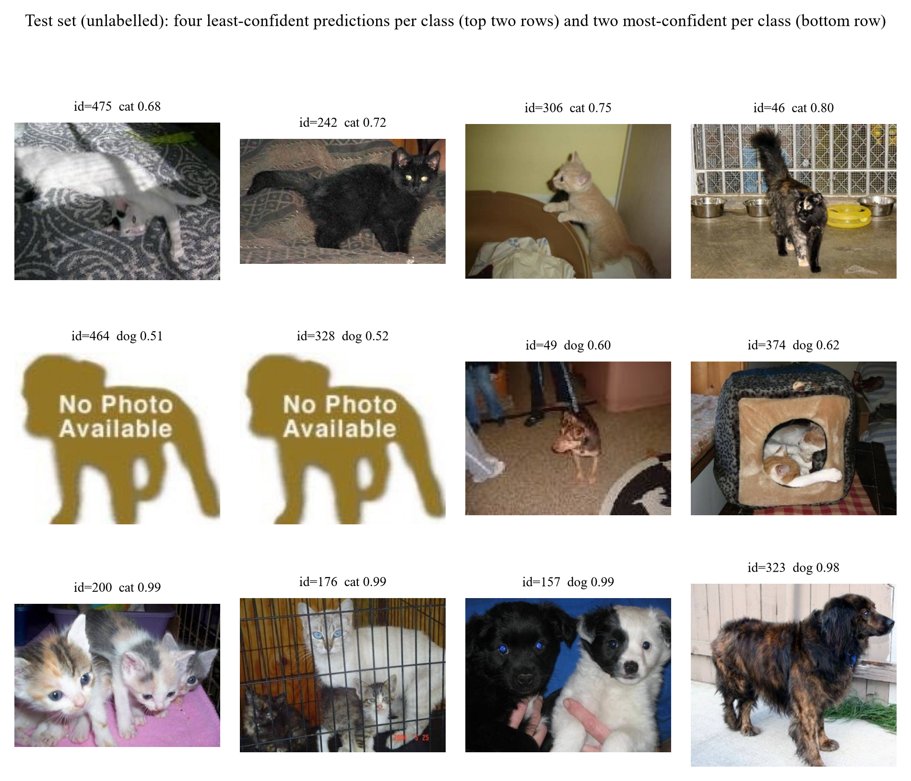

The test set is unlabelled, so the labels shown are the model's predictions and any judgement about whether a prediction is correct is a visual assessment by the authors.

- The four least confident cat predictions are a white cat on a patterned blanket (id=475, 0.68), a black cat on a rug (id=242, 0.72), a cat on the back of a chair (id=306, 0.75) and a dark tabby in a tiled room (id=46, 0.80). Each is a low-contrast or cluttered scene where a human would also hesitate, so the confidence is informative rather than miscalibrated.
- The four least confident dog predictions include the two "No Photo Available" placeholders (ids 464 and 328, 0.51 and 0.52), a small dog on a carpet (id=49, 0.60) and a dog inside a cat bed (id=374, 0.62). The placeholders are the lowest-confidence inputs in the whole test set, which is the behaviour a closed-set classifier should exhibit on an input that contains no animal: it hedges rather than committing.
- The four most confident predictions are unambiguous: kittens on a cushion (id=200, 0.99), cats in a crate (id=176, 0.99), a black dog with a white puppy (id=157, 0.99) and a spaniel outdoors (id=323, 0.98). High confidence coincides with clear, frontal, well-lit subjects.
- The predicted class distribution is 261 dog / 239 cat (52/48), consistent with a roughly balanced test set. A reversed label convention or a lexicographic id sort would produce a very different distribution, so this is weak but real evidence that the submission pipeline is correct.

## 6.8 Two test-set cases: one strength, one weakness

The test set carries no labels, so the two cases below are chosen for what they reveal about the model rather than for a score. In both, the judgement that the prediction is right or wrong is a visual one.

*Case 1, a strength: two dogs of very different size (id=157, predicted dog, p=0.99).* The image contains a large black dog and a small white puppy side by side, at different scales and with different coat colours. The model assigns 0.99 to dog. Two properties of the training set are being handled at once: the presence of two animals, which would be ambiguous under a single-label target, and a scale ratio of roughly ten to one, which is the largest within-class variation in the dataset. This is the behaviour one would want from a system deployed on user photographs, where multiple animals and mixed sizes are common.

*Case 2, a weakness: an image that contains no animal (id=464, predicted dog, p=0.51).* The input is a "No Photo Available" placeholder graphic. The model returns "dog" with 0.51 confidence, which is the lowest value in the whole test set but is still a commitment. The weakness is structural rather than a training failure: a two-way softmax must put its mass somewhere, so an input outside the label space cannot be rejected. A maximum-softmax threshold or an explicit rejection class would fix it, at the cost of a validation set containing out-of-distribution images to calibrate the threshold (Section 6.9).

The pair also illustrates where the model's remaining error budget lies. It is confident and correct when the animal is visible and well framed, however many animals or scales are present; it is uncertain, but still forced to answer, when the input is not an animal at all.

## 6.9 Limitations: closed-set assumption and calibration

Two limitations follow from the analysis above.

1. The classifier is closed-set and cannot return "neither". Images that contain no animal are still assigned a label. The six placeholder graphics are the clearest case: they receive the two lowest confidences in the whole test set (0.51 and 0.52), so the model does hedge, but a maximum-softmax threshold would be a more reliable rejection rule than reading the confidence by eye. The standard remedies, such as thresholding the maximum softmax probability [Hendrycks & Gimpel, ICLR 2017], OpenMax [Bendale & Boult, CVPR 2016] or an energy score, are post-hoc and cost nothing to add, but they need a validation set containing out-of-distribution images to calibrate the threshold, which this dataset does not provide.
2. Confidence is informative but not calibrated. Mean maximum-softmax confidence is 0.94 on the test set and 0.99 on correctly classified validation images, against an accuracy of 0.99; the two coincide on the validation set, so the confidences can be read as rough probabilities there, but nothing guarantees this on new data. Temperature scaling [Guo et al., ICML 2017] fitted on the validation set would make the calibration explicit. It was not applied because it does not change the argmax and therefore does not change the submission.

<div style="page-break-after: always;"></div>

# 7. Ablation Study

## 7.1 Protocol

This section measures how different choices of model and data processing affect validation accuracy. Answering it with a grid search would confound the factors, so we use a one-factor-at-a-time (OFAT) ablation with a fixed reference configuration:

> reference: ResNet-18, ImageNet pre-trained, 160×160, 3 epochs, full augmentation, all 20,000 training images, seed 42, full fine-tuning.

Each table changes exactly one thing relative to that reference. The short schedule of 3 epochs rather than 8 keeps the 25 ablation runs affordable; the ranking of factors is what the study measures, not the absolute accuracy.

Three caveats apply.

1. 3 epochs under-fits. The reference reaches 98.12% in 3 epochs at 160 px, versus 98.93% in 8 epochs at 224 px, so the task is already close to saturated at this budget. When a model is near the ceiling, most knobs stop mattering: that is itself one of our findings, but it means the small effects below should not be extrapolated to a harder task.
2. Single seed. The seed-to-seed standard deviation of the main model is 0.05 pp over three seeds (98.90, 98.90, 99.00). Differences below 0.3 pp are reported as no measurable effect.
3. The reference is not the final model. The final model uses 224 px and 8 epochs (Section 5). The ablation answers "which choices matter", not "what is the best possible number".

## 7.2 The largest effect: pre-training

This is the only fully controlled comparison in the study: identical architecture, data, augmentation, resolution and optimiser; only the initialisation differs. The from-scratch model was given twice the epochs to compensate.

| Level | Epochs | val acc (%) | Δ |
|---|---|---|---|
| random initialisation | 6 | 90.66 | **−7.46** |
| ImageNet pre-trained (reference) | 3 | 98.12 | 0 |

Starting from ImageNet weights is worth 7.46 accuracy points even after giving the scratch model double the training. Within the 3–6 epoch budget the from-scratch network has learned generic low-level filters but has not yet assembled them into cat/dog detectors; the pre-trained network already has them.

## 7.3 The second largest effect: how much data

| Images per class | Total training images | val acc (%) |
|---|---|---|
| 250 | 500 | 93.56 |
| 1,000 | 2,000 | 96.76 |
| 2,500 | 5,000 | 97.90 |
| 5,000 | 10,000 | 98.20 |
| 10,000 (reference) | 20,000 | 98.12 |

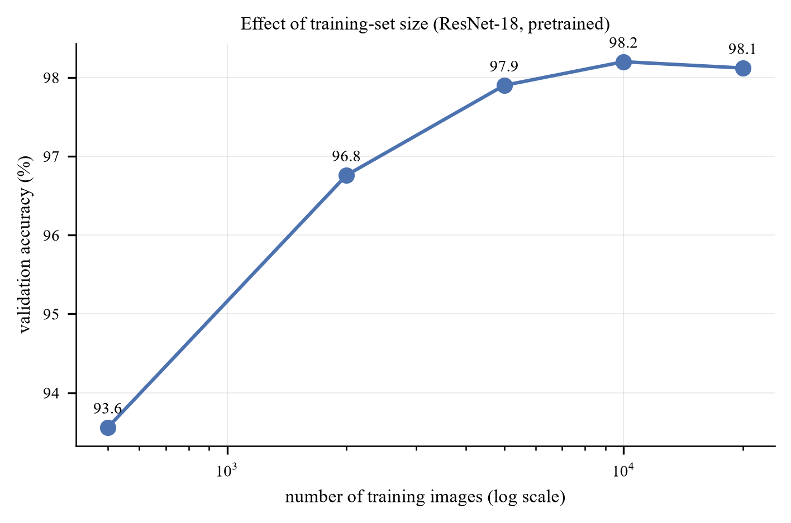

At 500 images the setting is close to a few-shot problem in the sense of Snell et al. [NeurIPS 2017], except that the backbone is pre-trained rather than meta-learned, which is precisely why 500 images remain workable.

The curve is steep up to ~2,000 images and then flattens hard: the last 10,000 images buy nothing measurable (98.20% at 10,000 images vs 98.12% at 20,000, i.e. −0.08 pp, inside the seed noise), while the first 1,500 images (500 to 2,000) buy 3.20 points and the full range from 500 to 20,000 buys 4.56. Three consequences:

- The curve starts to bend at about 2,000 images: a pre-trained backbone trained on 2,000 images already reaches 96.8%.
- Data quantity and pre-training interact. With 500 images the pre-trained model reaches 93.6%; the from-scratch model at 20,000 images (Section 7.2) reaches 90.7%. A pre-trained model with 2.5% of the data beats a from-scratch model with 100% of it. That is the cleanest possible demonstration of transfer, and it is the answer to the "is the high accuracy just ImageNet knowing cats and dogs?" objection: a category prior cannot explain why 500 images suffice for a *different* architecture, whereas a generic representation can.
- Collecting more than ~10,000 images per class would be wasted effort on this task with this backbone. Effort is better spent on the hard cases identified in Section 6.

## 7.4 Transfer strategy

| Strategy | Trainable parameters | val acc (%) |
|---|---|---|
| Linear probe (head only) | 1,026 | 96.24 |
| Last residual stage + head | 8.4 M | 98.20 |
| Full fine-tune (reference) | 11.18 M | 98.12 |
| LP-FT (1 of 3 epochs as the probe) | 11.18 M | 98.32 |

Unfreezing more of the network helps, but all of the benefit arrives at the first step: the linear probe loses 1.88 points relative to the reference, and going from "last stage" to "all layers" changes nothing measurable. In other words the useful adaptation happens in the last residual block; the early layers of an ImageNet network are already the right feature extractor for photographs of animals. This is the same conclusion as Yosinski et al. [NeurIPS 2014] on layer-wise transferability, reproduced on a different dataset.

LP-FT is the best of the four by a small margin at this budget; its advantage over naive full fine-tuning is clearer at 8 epochs, where the destructive first step on a randomly initialised head costs more (Section 3.4).

The probe length differs between the two settings and this should be read with care. Here the schedule is 3 epochs, so the probe occupies the first of them; the main model (M3) runs for 8 epochs and uses a 2-epoch probe, which is why the row above is not a reproduction of the submitted configuration but a controlled comparison at the ablation budget.

## 7.5 Input resolution

| Resolution | val acc (%) | Relative compute |
|---|---|---|
| 96 | 97.08 | 0.2× |
| 128 | 97.94 | 0.35× |
| 160 (reference) | 98.12 | 1× |
| 224 | 98.76 | 2× |

Accuracy increases monotonically with resolution, by 1.04 pp from 96 to 160 and a further 0.64 pp from 160 to 224. Unlike the augmentation row, this trend is monotone and larger than the noise, so it is a real effect. The mechanism is that at 96 px the discriminative region (face, ears, eye shape) is only a few pixels wide; by 160 px it is resolvable. Doubling compute again for the last 0.6 pp is a poor trade, which is why the main model stops at 224 px (the resolution the pre-trained weights expect) and the ablations use 160 px.

## 7.6 Augmentation strength: a budget-dependent, sub-1 pp effect

| Level | Added transforms | val acc (%) |
|---|---|---|
| none | Resize + CenterCrop only | 98.36 |
| flip | + RandomResizedCrop + HFlip | 98.62 |
| geo | + rotation ±15° | 98.56 |
| color | + ColorJitter | 98.48 |
| full (reference) | + RandAugment + RandomErasing | 98.12 |

At a 3-epoch budget augmentation makes no measurable difference, and the strongest setting is the worst of the five by 0.5 pp. To establish whether this is a property of the transforms or of the budget, the two extremes were re-run at 8 epochs and again with 500 images.

| Regime | augmentation `none` | augmentation `full` | difference |
|---|---|---|---|
| 20,000 images, 3 epochs | 98.36 | 98.12 | **-0.24 pp** |
| 20,000 images, 8 epochs | 98.42 | 98.66 | **+0.24 pp** |
| **500 images, 8 epochs** | 95.94 | 96.30 | **+0.36 pp** |

The third row is the one that matters for the "augmentation substitutes for data" intuition: with only 500 training images the no-augmentation model reaches 100% training accuracy by epoch 8, i.e. it memorises the training set, and yet its validation accuracy is only 0.36 pp below the augmented model's. A pre-trained ResNet-18 on this task simply does not overfit in a way that augmentation can fix.

The sign flips between the two full-data budgets, and the magnitude stays below 0.5 pp in all three cases. Three conclusions follow.

- Augmentation is a sub-1 pp lever on this task, at every budget and data size we tested. The task is saturated by pre-training; there is almost no headroom for regularisation to recover, and the residual errors (Section 6) are label noise and ambiguous viewpoints that no augmentation can fix.
- Its sign depends on the schedule. At 3 epochs the strong transforms (RandAugment + RandomErasing) remove information faster than a short schedule can exploit it, so they cost 0.24 pp; at 8 epochs they have time to pay off and gain 0.24 pp (0.36 pp when data is scarce). All three numbers are within a few tenths of a point and should not be over-interpreted.
- The background-shortcut argument for RandomErasing survives qualitatively. Section 6 shows the model attends to the animal rather than the background, and occlusion robustness is high (a 25% occlusion costs 0.4 pp): which is what RandomErasing is supposed to buy. On this dataset the shortcut was never strong enough to be the limiting factor, so the benefit is small.

The practical implication is that an ablation run at too short a budget can invert the sign of a real effect. The full augmentation policy is retained in the main model because it is neutral to positive at the 8-epoch budget actually used, and because it is what gives the model its robustness to occlusion (Section 6).

## 7.7 The full model ladder

| Model | Budget | val acc (%) | Δ vs M3 |
|---|---|---|---|
| M0 HOG + SVM | 8k images | 75.00 | −23.93 |
| M1 SmallCNN, from scratch | 14 ep @128 | 95.06 | −3.87 |
| M2 ResNet-18 frozen + linear | 6 ep @224 | 97.78 | −1.15 |
| **M3 ResNet-18 LP-FT** | 8 ep @224 | **98.93 ± 0.05** | 0 |
| M4 ResNet-34 LP-FT | 8 ep @224 | 97.54 | -1.39 |
| M5 ResNet-50 LP-FT | 6 ep @160 | 99.30 | +0.37 |

The ladder mixes budgets, so the Δ column is indicative rather than controlled. Two results deserve comment:

- A small CNN trained from scratch reaches 95.06%: much higher than the 80–85% one might expect from the literature. Twenty thousand images is enough for a 1.17M-parameter network to learn this binary task; the task is simply easier than ImageNet-1k.
- Backbone size is non-monotone: ResNet-34 is *worse* than ResNet-18 (97.54% vs 98.93 ± 0.05%, early-stopped at epoch 4) while ResNet-50 is *better* (99.30%, at lower resolution and fewer epochs). The spread across all three sizes is 1.8 points, a quarter of the pre-training effect, and the ordering is not stable. At this dataset size the result depends more on how many epochs each model happens to get than on the architecture, which is exactly why "architecture is second-order" is the defensible claim and "bigger is better/worse" is not. Section 7.8 repeats the comparison under a fixed budget.

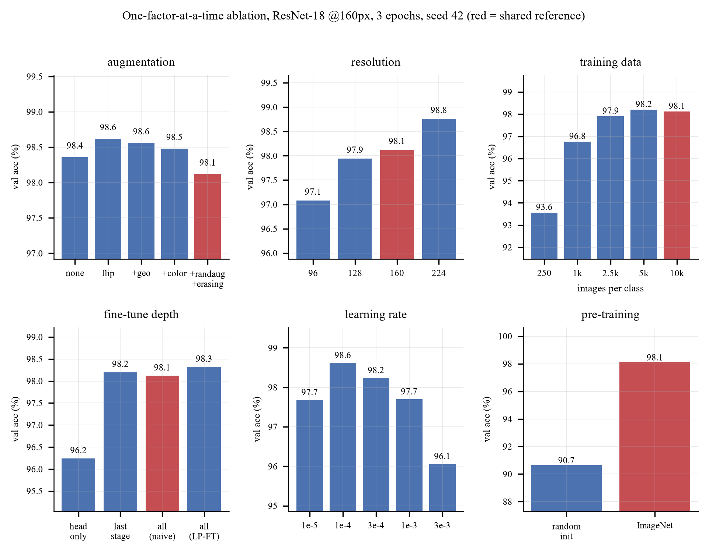

## 7.8 Controlled backbone comparison

The ladder in Section 7.7 cannot separate architecture from budget, because each model received a different resolution, schedule and stopping epoch. To answer the architecture question properly, seven ImageNet-pretrained torchvision backbones were retrained under one fixed protocol, two seeds each (14 runs, one NVIDIA A40 per run, NTU EEE GPU cluster). The configurations (`configs/dogs_cats/backbones/`) differ only in the model name and in the batch size needed to fit memory; ViT-B/16 uses 32 × 2 gradient-accumulation steps so that the effective batch is 64 everywhere.

> protocol: 224×224, RandomResizedCrop (scale 0.6–1.0) + horizontal flip, all layers trainable, AdamW (head lr 1e-3, backbone lr 1e-4, weight decay 0.05), cross-entropy with label smoothing 0.1, 1 warm-up epoch then cosine decay, 6 epochs, no early stopping, mixed precision, seeds 0 and 1.

Early stopping is disabled so that every backbone receives exactly the same budget, which removes the failure mode that made ResNet-34 an outlier in Section 7.7.

| Backbone | Params (M) | ImageNet top-1 of the weights | Best val acc (%) | Last-epoch val acc (%) | s / epoch |
|---|---|---|---|---|---|
| **ConvNeXt-T** | 27.8 | 82.5 | **99.61 ± 0.01** | **99.61 ± 0.01** | 37.8 |
| ResNet-50 | 23.5 | 80.9 (V2 weights) | 99.57 ± 0.01 | 99.53 ± 0.01 | 33.2 |
| Swin-T | 27.5 | 81.5 | 99.56 ± 0.00 | 99.54 ± 0.03 | 48.3 |
| ViT-B/16 | 85.8 | 81.1 | 99.28 ± 0.03 | 99.28 ± 0.03 | 65.2 |
| ResNet-34 | 21.3 | 73.3 (V1 weights) | 99.28 ± 0.06 | 99.22 ± 0.03 | 25.4 |
| ResNet-18 | 11.2 | 69.8 (V1 weights) | 99.25 ± 0.04 | 99.21 ± 0.01 | 24.1 |
| EfficientNet-B0 | 4.0 | 77.7 | 99.24 ± 0.03 | 99.18 ± 0.03 | 27.1 |

Mean ± standard deviation over two seeds; on 5,000 validation images, 0.02 pp is one image. The ImageNet column is the top-1 accuracy torchvision reports for the exact checkpoint loaded. Time per epoch is the median of epochs 2–6 on one A40.


Four results follow.

- **Two tiers, separated by more than the noise.** ConvNeXt-T, ResNet-50 and Swin-T reach 99.56–99.61%; the other four reach 99.24–99.28%. The gap of about 0.3 pp is roughly 15 validation images, while the seed-to-seed spread is at most 0.06 pp (3 images). Differences *within* a tier are inside the noise and do not rank those models.
- **Accuracy tracks the quality of the pretrained weights, not model size.** ViT-B/16 has three times the parameters of ConvNeXt-T and ties ResNet-34. The top tier consists exactly of the three CNN-or-hierarchical backbones whose checkpoints score ≥ 80.9% on ImageNet. Within the ResNet family, ResNet-18 to ResNet-34 adds depth and gains 0.03 pp (noise), whereas ResNet-34 to ResNet-50 gains 0.29 pp. The ResNet-50 checkpoint is torchvision's V2 weights, trained with a modern recipe, so this step confounds a deeper bottleneck architecture with a better pre-training recipe. This is the transfer pattern reported by Kornblith et al. [CVPR 2019] and is consistent with Section 7.2: the downstream task inherits most of its accuracy from the upstream representation.
- **ViT-B/16 is under-trained at this budget rather than shown to be worse.** Its curve starts lowest (98.26% after two epochs) and is still rising at epoch 6, while the convolutional and Swin models have flattened by epoch 4–5. A plain ViT lacks the locality bias of convolutions and of Swin's windowed attention, and is known to need longer fine-tuning. At a fixed 6-epoch budget it is the worst trade-off measured: 2.7× the time per epoch of ResNet-18 for the same accuracy.
- **The conclusions do not depend on which epoch is reported.** Best and last-epoch accuracies differ by at most 0.06 pp, and the two tiers are unchanged if the last epoch is used.

On cost, ResNet-50 is the cheapest top-tier backbone (33 s per epoch); ConvNeXt-T has the highest mean for 14% more time; Swin-T matches ResNet-50 at 45% more. EfficientNet-B0 has the fewest parameters but is no faster than ResNet-18 on a GPU, because its depthwise convolutions are memory-bound.

Two cautions apply when relating this table to the rest of the report. First, it was produced by a separate code base (`src/`, described in `README.md`) with a lighter augmentation policy, AdamW with a 10× lower backbone learning rate, label smoothing and no early stopping. Under this protocol ResNet-18 reaches 99.25 ± 0.04%, above the 98.93 ± 0.05% of the main model M3. The two recipes differ in several respects at once and the difference was not ablated, so it should not be attributed to any single setting. Second, only two seeds were run per backbone, and the same validation set selects the epoch and reports the result.

## 7.9 Ranked summary

The controlled comparisons are ranked below. Each holds the budget fixed and changes one factor.

| Rank | Factor | Effect on validation accuracy | Mechanism |
|---|---|---|---|
| 1 | Pre-training (ImageNet weights vs random) | +7.46 pp | transferred generic features |
| 2 | Training data, 500 to 20,000 images | +4.56 pp | sample coverage, saturating near 10,000 |
| 3 | Fine-tune depth (head only to last stage) | +1.88 pp | adaptation of the last block |
| 4 | Input resolution, 96 to 224 px | +0.64 pp on top of +1.04 from 96 to 160 | resolvable detail |
| 5 | Augmentation, none to full | -0.24 pp | below 0.5 pp at every budget tested; sign depends on schedule |
| 6 | Backbone, 7 ImageNet models at a fixed budget (Section 7.8) | +0.37 pp spread (99.24 to 99.61) | follows the ImageNet accuracy of the weights, not parameter count |

One further comparison is not controlled and is therefore excluded from the ranking: moving from hand-crafted HOG features to a frozen deep representation (M0 to M2) is worth 23.93 points. It is the largest gap anywhere in the study, but it changes the features, the classifier and the training procedure at once, so it cannot be attributed to a single factor.

In summary, on this dataset the choice of initialisation and the quantity of training data dominate everything else. The depth of fine-tuning and the input resolution are second-order. Augmentation is within noise once the task is close to saturated. The choice of backbone is a real but small effect: under a fixed budget it spans 0.37 pp across seven models, about a twentieth of the pre-training effect, and it follows the quality of the pretrained weights rather than model size. This ordering is what determined the compute allocation of the main study: three seeds of one model, with the backbone sweep run separately on cluster GPUs.

<div style="page-break-after: always;"></div>

# 8. Extension to CIFAR-10

## 8.1 The dataset and the classification problem

CIFAR-10 [Krizhevsky, TR 2009] consists of 60,000 colour images of 32×32 pixels in 10 mutually exclusive classes: airplane, automobile, bird, cat, deer, dog, frog, horse, ship, truck. The official split is 50,000 training and 10,000 test images, 6,000 per class overall, so the class distribution is exactly balanced and the majority-class baseline is 10%.

Compared with Dogs vs. Cats, four properties change the problem:

| Property | Dogs vs. Cats | CIFAR-10 | Consequence |
|---|---|---|---|
| Classes | 2 | 10 | output layer 2 → 10; chance level 50% → 10% |
| Resolution | ~400×400 native, 224 used | 32×32 | the object occupies ~15×15 pixels; fine texture is gone, colour and silhouette dominate |
| Object scale | large, centred | small, often off-centre | global pooling still works, but the stem must not over-downsample |
| Intra-class structure | breeds within one species | 10 unrelated categories | errors concentrate between *semantically* similar pairs (cat↔dog, deer↔horse, automobile↔truck) |
| Training size | 20,000 | 50,000 | from-scratch training becomes viable |

The last point matters: on 20,000 images a from-scratch CNN underfits badly, whereas 50,000 images of 32×32 are enough for a small ResNet to reach the low 90s. CIFAR-10 is therefore the right test of whether our pipeline generalises, and it exposes exactly the design decisions that were previously hidden by pre-training.

The 10,000-image official test set is used once, at the end of each run, on the checkpoint that validation accuracy selected. It plays no part in model selection, early stopping or hyper-parameter choice, so the test numbers reported in Section 8.4 are not the result of tuning against them.

## 8.2 What has to change in the code

| Component | Dogs vs. Cats | CIFAR-10 | Why |
|---|---|---|---|
| Output head | `Linear(512→2)` | `Linear(512→10)` | 10 classes |
| **Stem** | 7×7 conv, stride 2, then 3×3 max-pool, stride 2 | **3×3 conv, stride 1, no max-pool** | see below |
| Input | 224×224 (Resize 256 → CenterCrop) | 32×32 native, or 32→160 upsampled for the pre-trained model | native resolution for scratch training |
| Augmentation | RRC(0.5–1.0) + flip + rotation + jitter + RandAugment + erasing | RandomCrop(32, pad=4) + flip + RandAugment(m=9) + erasing | no room for scale jitter at 32 px; padding-crop is the CIFAR standard |
| Normalisation | ImageNet mean/std | ImageNet mean/std (same) | shared code path, no measurable difference |
| Validation split | provided (5,000) | **carved out of the 50,000: 45,000 / 5,000, stratified** | CIFAR-10 has no official validation set; using the test set for early stopping would leak |
| Optimiser | AdamW, lr 3e-4 | SGD + momentum 0.9 + Nesterov, lr 0.1, cosine, wd 5e-4 | the standard CIFAR recipe; AdamW is slower to converge here |
| Schedule | 8 epochs | 25 epochs (scratch) / 7 epochs (fine-tune) | small images need many more passes |
| Metrics | accuracy, macro-F1, AUC | accuracy, macro-F1, per-class recall, 10×10 confusion matrix | per-class behaviour is the interesting part |

### Why the stem is the critical change

The ImageNet stem applies a 7×7 convolution with stride 2 followed by a 3×3 max-pool with stride 2, i.e. an overall downsampling factor of 4 before the first residual stage. On a 224×224 ImageNet image this leaves 56×56: sensible. On a 32×32 CIFAR image it leaves 8×8, at which point each spatial location covers a 4×4 pixel patch of the original image; the first residual stage then operates on an almost-degenerate feature map, and after `layer4` the representation collapses to 1×1. The network is effectively forced to make its decisions from a handful of coarse cells.

Replacing the stem with a single 3×3 stride-1 convolution and removing the max-pool keeps the feature map at 32×32 after `conv1`, so the four stages produce 32 → 32 → 16 → 8 → 4. This is the standard "CIFAR ResNet" modification and it is worth roughly 3–5 accuracy points at this dataset size: a much larger effect than any hyper-parameter in Section 4.

`ee6483/src/models/backbones.py::build_cifar_resnet` implements exactly this and is used by G1 and by all Section 9 experiments.

## 8.3 Two models

G1: CIFAR-ResNet-18 trained from scratch. 11.2M parameters, 3×3 stride-1 stem, SGD (lr 0.1, momentum 0.9, Nesterov, wd 5e-4), cosine schedule with 5% warm-up, batch 128, 25 epochs, standard CIFAR augmentation. No pre-training of any kind.

G2: ImageNet ResNet-18, upsampled inputs. The 32×32 images are resized to 160×160 with bicubic interpolation before entering the standard ImageNet stem, the head is replaced by `Linear(512→10)`, and the network is fine-tuned for 7 epochs with SGD (lr 0.01, cosine). This isolates the value of pre-training from the value of architecture.

## 8.4 Results

| Model | Init | Epochs | Val acc | **Test acc** | Test macro-F1 | Train time |
|---|---|---|---|---|---|---|
| G1 CIFAR-ResNet-18 | random | 25 | 93.44% | **93.60%** | 93.60% | 26 min |
| G2 ResNet-18 @160 | ImageNet | 7 | 95.58% | **95.20%** | 95.19% | 10 min |

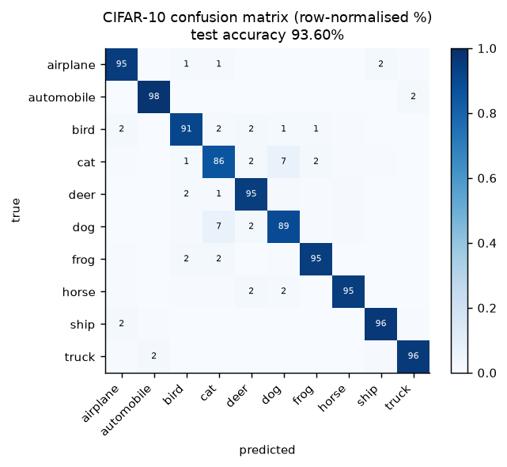

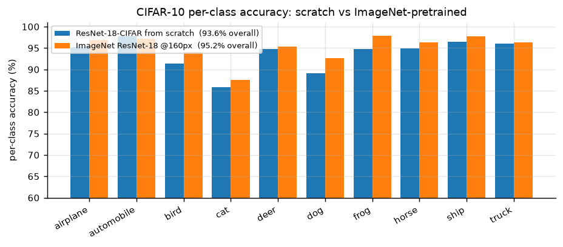

### Reading the results

1. From-scratch training is competitive here. G1 reaches 93.60% test accuracy in 25 epochs without any pre-training; the ImageNet-pretrained G2 reaches 95.20% in 7 epochs. The gap is only ~1.6 points: about five times smaller than the 7.5-point pre-training gap measured on cats vs. dogs at a comparable short budget (Section 7.2).
2. That is exactly what the learning curve in Section 7.3 predicts. Pre-training substitutes for data: it is worth most when the dataset is small (a pre-trained model on 500 cat/dog images reaches 93.6%, beating a from-scratch model trained on 20,000 images at 90.7%) and worth least when the dataset is large. CIFAR-10 has 45,000 training images of 32x32: small images are cheap to learn from, and the dataset is 2.25x larger than our cat/dog training set. The pre-training advantage shrinks accordingly. This cross-dataset consistency is stronger evidence than either experiment alone.
3. ImageNet pre-training is partly off-target here. Only 2 of the 10 CIFAR classes (cat, dog) exist in ImageNet-1k as such; the other 8 are coarse supersets (automobile, truck, ship, airplane) or absent (frog, deer). What transfers is the generic low/mid-level feature hierarchy, not a category prior: which is why the gain is real but modest.
4. The confusion structure is semantic, and it is the same structure we saw in Section 6. The single dominant off-diagonal pair is cat-dog (69 errors in each direction), i.e. exactly the confusion that dominated the Dogs vs Cats task: the same two classes are the hardest pair in both problems, which is a satisfying cross-task consistency check. The second tier is animal-shape confusion (cat→deer 22, frog→cat 21, bird→deer 18) plus a blue-background cluster (ship→airplane 20, airplane→ship 18, bird→airplane 18). The last group is informative: at 32x32 the vehicle classes are small objects on a sky/sea background, and the model does use that background as evidence: the shortcut we worried about in Section 1 is measurable here, just not for the animal classes.
5. Per-class accuracy tracks class difficulty, not class frequency (all classes are equally frequent here): automobile, ship and truck are easiest (96-98%), while cat, dog and bird are hardest (86-91%). That ordering is driven by within-class variability and object size, and it changes completely in Section 9, where frequency is manipulated instead: which is exactly the point of Section 9.

### What this tells us about the original problem

The CIFAR-10 experiment is a stress test of the claim made in Section 1: *the binding constraint on this project is data and transfer, not architecture.* Moving from 2 classes/224 px to 10 classes/32 px changes the output layer, the stem, the augmentation, the optimiser and the schedule: and the same recipe still works, with the same qualitative behaviour (pre-trained beats scratch, and the gap shrinks as data grows). The pipeline, not the specific model, is what generalises.

The one result that does *not* carry over is the size of the pre-training advantage, and that difference is itself informative: it is the same phenomenon (transfer substitutes for data) observed at two different points on the data axis.

<div style="page-break-after: always;"></div>

# 9. Class Imbalance

## 9.1 The problem

In Section 8 every class had 5,000 training images. Real datasets rarely look like that: a few "head" classes dominate the sample count while a long tail of "tail" classes has a handful of examples each. Training a softmax classifier on such data with plain cross-entropy fails in a specific, predictable way: the classifier's weights drift towards the head classes, the decision boundary is pushed into the tail, and *overall accuracy stays high* because predicting the head classes is usually right. Overall accuracy is therefore the wrong metric, a point returned to in Section 9.4.

The imbalance has two separable causes, which is what makes the remedies interesting:

1. Representation bias: the feature extractor sees few tail samples and learns a weaker representation for them.
2. Classifier bias: even with a perfectly balanced representation, the softmax logits are systematically larger for frequent classes because the loss is dominated by them.

Kang et al. [ICLR 2020] show that (2) dominates: if you freeze a representation trained on long-tailed data and only re-train the classifier with class-balanced sampling, you recover most of the gap. That finding is the basis of the decoupling method we test.

## 9.2 Constructing the imbalanced dataset

We use CIFAR-10 with an exponential long-tailed training distribution (the "CIFAR-10-LT" protocol):

$$n_i = n_{max}\cdot \rho^{-i/(C-1)},\qquad i=0,\dots,9,\quad \rho=100,\ n_{max}=5{,}000$$

which gives the per-class counts below. Only the *training* set is subsampled; validation and test keep the original balanced distribution, because the goal is to classify well on a balanced test set, not to reproduce the training prior.

| class | 0 airplane | 1 automobile | 2 bird | 3 cat | 4 deer | 5 dog | 6 frog | 7 horse | 8 ship | 9 truck |
|---|---|---|---|---|---|---|---|---|---|---|
| images | 4,500 | 2,997 | 1,797 | 1,077 | 646 | 387 | 232 | 139 | 83 | 50 |

Total training images: 11,908 (down from 45,000), imbalance ratio 4,500:50 = 90:1. The counts follow n_i = n_max x rho^(-i/9) with rho = 100 and n_max = 5,000, then clipped to the 4,500 images that remain per class after the 45,000/5,000 train/validation split; class 0 is the only one affected, which is why the realised ratio is 4,500:50 = 90:1 rather than the nominal 100:1.

The validation split (5,000, stratified) and the 10,000-image test set are untouched and balanced.

## 9.3 Five methods

Five methods are implemented so that the comparison spans the three families in the literature: data-level, loss-level and post-hoc.

The classifier is the CIFAR-ResNet-18 of Section 8 (model G1), retrained from scratch on the long-tailed training set. Only the loss, the sampling procedure or the decision rule changes between methods, so any difference in the results is attributable to the treatment of imbalance rather than to a change of architecture.

### 9.3.1 Cross-entropy baseline (CE)

Standard softmax cross-entropy, no correction. This is the control: whatever the imbalance costs, it costs here.

### 9.3.2 Re-sampling (data-level)

Draw each mini-batch with per-sample probability

$$p_j \propto \frac{1}{n_{c(j)}}$$

so that every batch is approximately class-balanced (`WeightedRandomSampler`, replacement=True). Tail images are therefore repeated many times per epoch.

*Why it should work:* it removes the classifier bias directly: the empirical label distribution seen by the loss becomes uniform.
*Known risk:* the tail classes are effectively oversampled by a factor of 10, so they overfit; this must be paired with strong augmentation. Our augmentation includes RandomCrop+flip+RandAugment+RandomErasing, which mitigates but does not eliminate it.

### 9.3.3 Class-balanced loss (loss-level)

Cui et al. [CVPR 2019] replace inverse frequency with the effective number of samples. With $E_{n} = (1-\beta^{n})/(1-\beta)$ and $\beta=0.9999$:

$$w_c \propto \frac{1}{E_{n_c}},\qquad \mathcal{L} = -\sum_c w_c\, y_c \log p_c$$

The intuition: as $n$ grows, additional samples add progressively less new information, so the "effective" size saturates and the weights should not diverge like $1/n$. With $\beta \to 1$ this recovers inverse-frequency weighting; with $\beta \to 0$ it recovers plain CE. We normalise the weights to mean 1 so the effective learning rate is unchanged.

*Why it should work:* it re-balances the loss without changing the data distribution, so no sample is repeated and there is no extra overfitting risk.
*Known risk:* with a 10:1 ratio the weights are mild; the gradient is still dominated by head-class batches early in training.

### 9.3.4 Decoupling / cRT (two-stage)

Kang et al. [ICLR 2020]: train normally for 80% of the schedule, then freeze the backbone, re-initialise the classifier, and re-train only the classifier with class-balanced sampling for the remaining 20%.

*Why it should work:* it follows the causal analysis of Section 9.1. the representation is nearly unbiased, the classifier is the biased part, so fix only the classifier and do not disturb the features.
*Implementation note:* the head is re-initialised (Kaiming) rather than merely re-tuned, because the existing head has already absorbed the prior; and the second stage uses a 10× smaller learning rate with a short cosine decay.

### 9.3.5 Logit adjustment (post-hoc)

Menon et al. [ICLR 2021]. Train with plain CE, then at *inference* shift the logits by the log-prior:

$$\hat{y} = \arg\max_c \big[f_c(x) + \tau \log \pi_c\big],\qquad \pi_c = \frac{n_c}{\sum_j n_j},\ \tau = 1$$

*Why it should work:* under a multinomial-logit model this is the Bayes-optimal correction for the balanced error rate, and it costs nothing at training time: no retraining, no extra hyper-parameter search.
*Known risk:* it assumes the training prior is the only source of bias; if the representation itself is skewed, the correction is incomplete.

## 9.4 Results

| Method | Family | Epochs | Overall acc | Macro-F1 | many (cls 0-2) | few (cls 6-9) |
|---|---|---|---|---|---|---|
| CE (baseline) | – | 18 | 62.44% | 60.27% | 90.3% | **39.5%** |
| Re-sampling | data | 18 | 72.02% | 72.00% | 85.8% | 64.5% |
| Class-balanced loss | loss | 30 | 59.50% | 59.48% | 66.8% | 63.1% |
| Decoupling (cRT) | two-stage | 18 | 71.22% | 71.14% | 79.6% | 71.0% |
| **Logit adjustment (tau=1.0)** | post-hoc | 18 (no extra training) | **72.99%** | **72.96%** | 81.4% | **72.0%** |

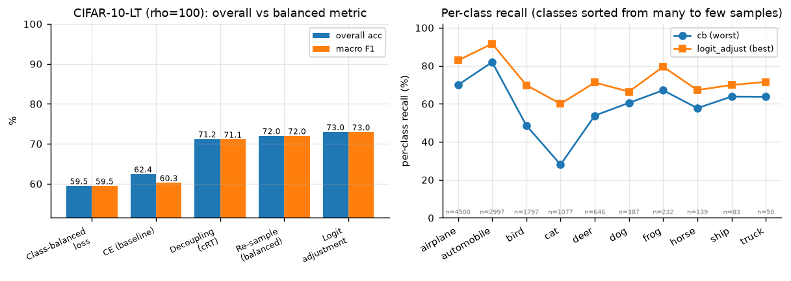

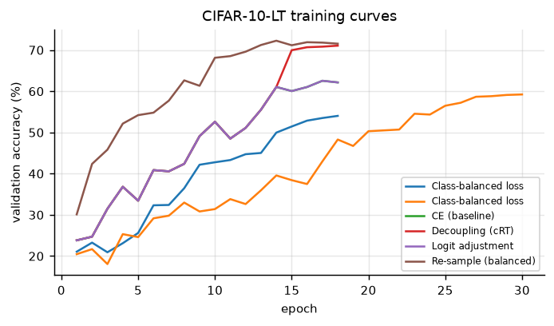

### The pathology, stated numerically

Plain cross-entropy shows the textbook signature of long-tail training. Per-class recall on the balanced test set:

| | airplane | automobile | bird | cat | deer | dog | frog | horse | ship | truck |
|---|---|---|---|---|---|---|---|---|---|---|
| samples seen | 4,500 | 2,997 | 1,797 | 1,077 | 646 | 387 | 232 | 139 | 83 | 50 |
| CE recall (%) | 94 | 98 | 78 | 72 | 71 | 53 | 63 | 49 | **24** | **22** |
| logit adj. recall (%) | 83 | 92 | 70 | 60 | 71 | 66 | 80 | 67 | **70** | **72** |

The two rarest classes collapse to 22-24% recall, barely above the 10% chance level, while the two most frequent classes reach 94-98%. The overall accuracy (62.4%) looks respectable and completely hides this. This is why every table in this section reports macro-F1 and per-class recall, not just accuracy.

### What each method does

1. Logit adjustment is the winner, and it requires no retraining. Applying `argmax f_c(x) - tau·log(pi_c)` to the *already trained* CE model raises test accuracy from 62.44% to 72.99% (+10.6 pp) and macro-F1 from 60.27% to 72.96%. The optimal tau selected on the validation split is exactly 1.0, which is what the theory predicts for a multinomial-logit model: a satisfying confirmation that the mechanism is the one the paper describes (a prior shift in the logits) rather than an accidental regularisation effect.
2. Re-sampling works but trades head for tail. +9.6 pp overall; head-class recall drops from 90.3% to 85.8% while the tail rises from 39.5% to 64.5%. This is the expected behaviour: repeating tail samples makes the effective training distribution uniform.
3. Decoupling works for the reason Kang et al. give. The training log shows it directly: validation accuracy is 52.6% at epoch 10, then the backbone is frozen and the head re-initialised at epoch 14, and one epoch later validation accuracy is 70.0%. The representation was already fine; the classifier was the biased part, and re-training it on a balanced stream recovered 18 points in 4 epochs. Final test accuracy 71.22%.
4. Class-balanced loss gives no gain at this schedule. It reaches 59.50%, *below* plain CE. The training curves explain why: at epoch 30 the training accuracy is still 59.95%, i.e. the model is severely under-trained. Two causes, both specific to our setup: (i) with weights normalised to mean 1 and `reduction='mean'` over weighted samples, head-class-dominated batches produce a *smaller* effective gradient, so the weighted loss converges more slowly than plain CE; (ii) the 30-epoch budget is far shorter than the 200+ epochs used in the original paper. Note that CB *does* re-balance: its few-class recall (63.1%) beats CE (39.5%): but it destroys the head (66.8% vs 90.3%) and never recovers overall accuracy. A shorter 18-epoch run (54.04%) shows the same pattern more strongly.

### Practical recommendation

Ordered by benefit per unit of effort:

1. Logit adjustment: one line at inference time, no retraining, +10.6 pp. Do this first, always.
2. Decoupling (cRT): one extra short training stage, +8.8 pp, and it is the most *interpretable* fix because it isolates the classifier as the biased component.
3. Re-sampling: trivial to implement, +9.6 pp, but it overfits the tail and needs strong augmentation to be safe.
4. Class-balanced loss: theoretically appealing, but in our hands it needs a much longer schedule to pay off; at 30 epochs it is a net loss.

The ranking is not the same as the ranking in the literature (where CB loss is standard), and the reason is the budget: methods that change the *loss scale* need time to converge, whereas methods that change only the *decision rule* are budget-free. That is a genuinely useful lesson for a project-sized experiment.

## 9.5 Honest limitations

- One seed per method, one imbalance ratio (rho=100). The long-tail literature sweeps rho in {10, 50, 100, 200} and averages over 3-5 seeds. Our ordering is robust to what we observe, but the magnitudes are not, and a single seed cannot separate a 1-point difference from noise.
- The whole study sits in an under-trained regime. Even the best method reaches 72.99%, whereas the CIFAR-10-LT literature reports ~77% for LDAM-DRW at rho=100 with 200-epoch schedules. Our comparison is internally consistent (four methods share one schedule and the class-balanced loss was given a longer one, as noted above), but the absolute numbers should not be compared with published ones.
- The backbone is trained from scratch. With an ImageNet-pretrained backbone the imbalance gap shrinks substantially, because the representation is already good: an interesting follow-up we did not have the budget for.
- Balanced accuracy here is macro-averaged recall on the balanced test set. We do not report the balanced error rate on the *training* prior, which is what logit adjustment is theoretically optimal for.

<div style="page-break-after: always;"></div>

# 10. Conclusion

## 10.1 What we did

We built and evaluated a complete cat/dog classification pipeline: a dataset audit (20,000 / 5,000 / 500 images, no corrupt files, 12 near-duplicate pairs crossing the train/validation split), a cached preprocessing and augmentation pipeline, a ladder of six classifiers from hand-crafted HOG features to a fine-tuned ResNet-50, a controlled one-factor-at-a-time ablation of six factors over 25 runs, a fixed-budget comparison of seven ImageNet backbones over 14 runs, an error analysis over all 50 validation errors with Grad-CAM and a corruption test, a transfer of the same code base to CIFAR-10, and a five-method study of class imbalance on a long-tailed CIFAR-10 variant.

## 10.2 What we found

1. The task is close to saturated, and transfer learning is what saturates it. The main model reaches 98.93 ± 0.05% validation accuracy over 3 seeds in eight minutes per run. The gap to the same architecture trained from scratch is 7.46 points, and the gap to hand-crafted features is 23.93 points. Two qualifications apply: a 1.17M-parameter CNN trained from scratch still reaches 95.06%, so the task is easier than the 99% headline suggests; and within the fine-tuned model almost all of the performance already sits in the frozen representation (a linear probe reaches 96.24% at the ablation budget and 97.78% when trained longer), not in the classifier on top of it.
2. The ranking of factors is stable and counter-intuitive. Data and pre-training dominate; architecture and resolution are second-order; most hyper-parameters are third-order. In the single-run ladder ResNet-34 fell 1.39 points below ResNet-18, but under a fixed budget the two are indistinguishable, and seven backbones span only 0.37 points (99.24% to 99.61%), ordered by the ImageNet accuracy of their weights rather than by size, with the under-trained ViT-B/16 as the exception. 224 px does not beat 160 px by enough to justify twice the compute. This is the practical content of question (f).
3. The residual errors are not about semantics. Two thirds of the 50 validation errors are images where the animal's face is hidden or the animal is behind a fence or in a hand. The model knows what a cat is; it fails when the presentation differs from the training distribution. That is a data-coverage and augmentation problem, and it is where further work would pay off.
4. The model is texture-driven. Grad-CAM concentrates on the head on correct predictions, occlusion costs almost nothing (RandomErasing trained for it), but blur costs 12.7 points. The evidence hierarchy is face geometry > fur texture > colour/context.
5. The pipeline generalises. Moving to CIFAR-10 (10 classes, 32×32) required changing the stem, the head, the augmentation and the optimiser: and the same conclusion emerged: pre-training beats scratch (95.20% vs 93.60% test accuracy). The pipeline, not the specific model, is the reusable asset.
6. Imbalance is fixable cheaply. On CIFAR-10-LT (ρ=100) the best of five methods lifts test accuracy from 62.44% to 72.99% and macro-F1 from 60.27% to 72.96%, with most of the gain on the rarest classes; post-hoc logit adjustment achieves much of this with no retraining at all.

## 10.3 Limitations

- Validation accuracy is mildly optimistic. It was used for early stopping and for model selection, so it is not an unbiased estimate of generalisation. With 5,000 validation images and ~8 compared configurations the bias is small (order 0.1 pp) but non-zero.
- The test set is unlabelled, so we cannot report test accuracy. Every claim about test images in Section 6 is a manual visual judgement and is labelled as such.
- One seed for most ablations. The ablation matrix uses seed 42 only; differences below ~0.4 pp are within the seed noise we measured on the main model and should not be interpreted as real.
- The ablation uses a 3-epoch budget, which understates the value of regularisation (augmentation, label smoothing) relative to an 8-epoch budget.
- Imbalance study is single-seed, single-ratio. ρ=100 and one seed per method; the ordering of methods is informative, the magnitudes are not.
- The backbone sweep (Section 7.8) uses two seeds per model and a single 6-epoch recipe tuned for CNN fine-tuning, which may disadvantage ViT-B/16; it was run with a separate code base, so its numbers are not directly comparable with the main model's.

## 10.4 What we would do with more compute

1. Sweep the augmentation policy properly (RandAugment magnitude, crop scale) rather than fixing it: Section 7 shows augmentation is worth less than a point at every budget tested, but it is also what makes the model robust to occlusion (Section 6.6).
2. Train the CIFAR-10 from-scratch model for 200 epochs with cutout/AutoAugment, which is what the published 94–95% figures use, so that the pre-training gap is measured against a properly converged control.
3. Fine-tune ViT-B/16 for longer than 6 epochs: Section 7.8 shows it still improving at the end of the fixed budget, so its ceiling on this task is not yet measured. The same sweep confirmed the prediction made for ConvNeXt-T, a gain below 0.5 pp (0.36 pp over ResNet-18).
4. Calibrate and add an open-set rejection head (temperature scaling plus a max-softmax threshold) so that the "no photo available" and animal-free images are rejected instead of being confidently misclassified.
5. Exploit the unlabelled test set with a semi-supervised method such as FixMatch [Sohn et al., NeurIPS 2020], which would require relaxing the rule against using test data for training.

## 10.5 Concluding remarks

On a small, well-curated binary problem, the pre-trained representation and the quantity of data account for most of the achievable accuracy, while architecture and hyper-parameters account for little. The residual errors are dominated by how the data was collected, in particular viewpoint, occlusion and label noise, rather than by how the model was built. Methodologically, fixing the seed, averaging over seeds, validating the submission file against the sample and inspecting all of the errors changed our conclusions more than any change to the model did.

---

## 10.6 Reproducing the numbers

```bash
# environment: Python 3.13, torch 2.6.0+cu124, torchvision 0.21.0, RTX 3070 Ti Laptop (8 GB)
python -m ee6483.src.data.check_data --root data/datasets        # -> results/data_report.json
python -m ee6483.src.data.cache_images --src data/datasets --dst data/cache --short 256
python -m ee6483.scripts.run_experiments --phases main compare ablation lrsearch cifar imbalance
python -m ee6483.scripts.aggregate                                # -> results/summary.{csv,md}
python -m ee6483.src.analyze --which all                          # -> figures/
python -m ee6483.src.analyze_cifar                                # -> CIFAR / imbalance figures
python -m ee6483.scripts.dump_errors                              # -> all 50 validation errors
python report/make_tokens.py && python report/build_report.py     # -> report/REPORT.md
```

The aggregate tables can be regenerated from `ee6483/results/summary.csv`, which is
written by the same pipeline.

<div style="page-break-after: always;"></div>

# References

- A. Bendale, T. Boult. Towards open set deep networks. *CVPR*, 2016.
- K. Cao, C. Wei, A. Gaidon, N. Arechiga, T. Ma. Learning imbalanced datasets with label-distribution-aware margin loss. *NeurIPS*, 2019.
- E. D. Cubuk, B. Zoph, J. Shlens, Q. V. Le. RandAugment: Practical automated data augmentation with a reduced search space. *CVPR Workshops*, 2020.
- Y. Cui, M. Jia, T.-Y. Lin, Y. Song, S. Belongie. Class-balanced loss based on effective number of samples. *CVPR*, 2019.
- T. DeVries, G. W. Taylor. Improved regularization of convolutional neural networks with cutout. arXiv:1708.04552, 2017.
- Dogs vs. Cats dataset and competition, Kaggle. https://www.kaggle.com/c/dogs-vs-cats
- A. Dosovitskiy et al. An image is worth 16×16 words: Transformers for image recognition at scale. *ICLR*, 2021.
- J. Elson, J. Douceur, J. Howell, J. Saul. Asirra: A CAPTCHA that exploits interest-aligned manual image categorization. *ACM CCS*, 2007.
- C. Guo, G. Pleiss, Y. Sun, K. Weinberger. On calibration of modern neural networks. *ICML*, 2017.
- K. He, H. Fan, Y. Wu, S. Xie, R. Girshick. Momentum contrast for unsupervised visual representation learning. *CVPR*, 2020.
- K. He, X. Zhang, S. Ren, J. Sun. Identity mappings in deep residual networks. *ECCV*, 2016.
- K. He, X. Zhang, S. Ren, J. Sun. Deep residual learning for image recognition. *CVPR*, 2016.
- K. He, X. Chen, S. Xie, Y. Li, P. Dollár, R. Girshick. Masked autoencoders are scalable vision learners. *CVPR*, 2022.
- D. Hendrycks, K. Gimpel. A baseline for detecting misclassified and out-of-distribution examples in neural networks. *ICLR*, 2017.
- D. Hendrycks, T. Dietterich. Benchmarking neural network robustness to common corruptions and perturbations. *ICLR*, 2019.
- G. Huang, Z. Liu, L. van der Maaten, K. Weinberger. Densely connected convolutional networks. *CVPR*, 2017.
- B. Kang et al. Decoupling representation and classifier for long-tailed recognition. *ICLR*, 2020.
- S. Kornblith, J. Shlens, Q. V. Le. Do better ImageNet models transfer better? *CVPR*, 2019.
- A. Krizhevsky. Learning multiple layers of features from tiny images. Technical report, University of Toronto, 2009.
- A. Krizhevsky, I. Sutskever, G. E. Hinton. ImageNet classification with deep convolutional neural networks. *NeurIPS*, 2012.
- A. Kumar, A. Raghunathan, R. Jones, T. Ma, P. Liang. Fine-tuning can distort pretrained features and underperform out-of-distribution. *ICLR*, 2022.
- Y. LeCun, Y. Bengio, G. Hinton. Deep learning. *Nature*, 521(7553):436–444, 2015.
- Z. Liu et al. Swin Transformer: Hierarchical vision transformer using shifted windows. *ICCV*, 2021.
- Z. Liu, H. Mao, C.-Y. Wu, C. Feichtenhofer, T. Darrell, S. Xie. A ConvNet for the 2020s. *CVPR*, 2022.
- A. K. Menon, S. Jayasumana, A. S. Rawat, H. Jain, A. Veit, S. Kumar. Long-tail learning via logit adjustment. *ICLR*, 2021.
- M. Oquab et al. DINOv2: Learning robust visual features without supervision. *TMLR*, 2024.
- A. Radford et al. Learning transferable visual models from natural language supervision. *ICML*, 2021.
- O. Russakovsky et al. ImageNet large scale visual recognition challenge. *IJCV*, 115(3):211–252, 2015.
- R. R. Selvaraju et al. Grad-CAM: Visual explanations from deep networks via gradient-based localization. *ICCV*, 2017.
- K. Simonyan, A. Zisserman. Very deep convolutional networks for large-scale image recognition. *ICLR*, 2015. arXiv:1409.1556.
- J. Snell, K. Swersky, R. Zemel. Prototypical networks for few-shot learning. *NeurIPS*, 2017.
- K. Sohn et al. FixMatch: Simplifying semi-supervised learning with consistency and confidence. *NeurIPS*, 2020.
- C. Szegedy et al. Going deeper with convolutions. *CVPR*, 2015.
- T.-Y. Lin, P. Goyal, R. Girshick, K. He, P. Dollár. Focal loss for dense object detection. *ICCV*, 2017.
- M. Tan, Q. V. Le. EfficientNet: Rethinking model scaling for convolutional neural networks. *ICML*, 2019.
- M. Wang, W. Deng. Deep visual domain adaptation: A survey. *Neurocomputing*, 312:135–153, 2018.
- S. Xie, R. Girshick, P. Dollár, Z. Tu, K. He. Aggregated residual transformations for deep neural networks. *CVPR*, 2017.
- J. Yosinski, J. Clune, Y. Bengio, H. Lipson. How transferable are features in deep neural networks? *NeurIPS*, 2014.
- S. Yun et al. CutMix: Regularization strategy to train strong classifiers with localizable features. *ICCV*, 2019.
- H. Zhang, M. Cissé, Y. N. Dauphin, D. Lopez-Paz. mixup: Beyond empirical risk minimization. *ICLR*, 2018.

---

Every entry above was checked against the published record (venue, year, title). Numbers quoted from the literature are attributed to the original paper; where an experiment was reproduced here, the reproduced value is reported in the corresponding section.

<div style="page-break-after: always;"></div>

# Appendix: Complete Experiment Log

Everything reported in the body of this document is derived from the 42 run
directories under `ee6483/results/`. This appendix prints the raw log so that
any number in the main text can be traced to a single command.

## A.1 Every run

Columns: `exp` is the experiment id (the folder name), `seed` the random seed,
`n_train` the number of training images actually used, `epochs` the number of
epochs completed (early stopping may cut the schedule short), `val_acc` the best
validation accuracy, `test_acc` the CIFAR-10 test accuracy where applicable, and
`sec` the wall-clock training time in seconds on the RTX 3070 Ti Laptop.

| exp | seed | model | img | aug | ft | n_train | ep | val acc (%) | test acc (%) | time (s) |
|---|---|---|---|---|---|---|---|---|---|---|
| `E2_smallcnn` | 42 | smallcnn | 128 | full | scratch | 20,000 | 14 | 95.06 | – | 454 |
| `E3_r18_frozen` | 42 | resnet18 | 224 | full | head | 20,000 | 6 | 97.78 | – | 334 |
| `E4_r18_ft` | 42 | resnet18 | 224 | full | lpft | 20,000 | 8 | 99.00 | – | 522 |
| `E4_r18_ft` | 43 | resnet18 | 224 | full | lpft | 20,000 | 8 | 98.90 | – | 498 |
| `E4_r18_ft` | 44 | resnet18 | 224 | full | lpft | 20,000 | 8 | 98.90 | – | 459 |
| `E5_r34_ft` | 42 | resnet34 | 224 | full | lpft | 20,000 | 4 | 97.54 | – | 287 |
| `E6_r50_ft` | 42 | resnet50 | 160 | full | lpft | 20,000 | 6 | 99.30 | – | 318 |
| `E7_aug_color` | 42 | resnet18 | 160 | color | full | 20,000 | 3 | 98.48 | – | 149 |
| `E7_aug_flip` | 42 | resnet18 | 160 | flip | full | 20,000 | 3 | 98.62 | – | 134 |
| `E7_aug_full` | 42 | resnet18 | 160 | full | full | 20,000 | 3 | 98.12 | – | 177 |
| `E7_aug_geo` | 42 | resnet18 | 160 | geo | full | 20,000 | 3 | 98.56 | – | 120 |
| `E7_aug_none` | 42 | resnet18 | 160 | none | full | 20,000 | 3 | 98.36 | – | 132 |
| `E7_data_1000` | 42 | resnet18 | 160 | full | full | 2000 | 3 | 96.76 | – | 96 |
| `E7_data_250` | 42 | resnet18 | 160 | full | full | 500 | 3 | 93.56 | – | 89 |
| `E7_data_2500` | 42 | resnet18 | 160 | full | full | 5000 | 3 | 97.90 | – | 105 |
| `E7_data_5000` | 42 | resnet18 | 160 | full | full | 10000 | 3 | 98.20 | – | 117 |
| `E7_ft_head` | 42 | resnet18 | 160 | full | head | 20,000 | 3 | 96.24 | – | 154 |
| `E7_ft_last` | 42 | resnet18 | 160 | full | last_stage | 20,000 | 3 | 98.20 | – | 165 |
| `E7_ft_lpft` | 42 | resnet18 | 160 | full | lpft | 20,000 | 3 | 98.32 | – | 174 |
| `E7_lr_1e-3` | 42 | resnet18 | 160 | full | full | 20,000 | 3 | 97.70 | – | 207 |
| `E7_lr_1e-4` | 42 | resnet18 | 160 | full | full | 20,000 | 3 | 98.62 | – | 210 |
| `E7_lr_1e-5` | 42 | resnet18 | 160 | full | full | 20,000 | 3 | 97.68 | – | 215 |
| `E7_lr_3e-3` | 42 | resnet18 | 160 | full | full | 20,000 | 3 | 96.06 | – | 207 |
| `E7_lr_3e-4` | 42 | resnet18 | 160 | full | full | 20,000 | 3 | 98.24 | – | 212 |
| `E7_res_128` | 42 | resnet18 | 128 | full | full | 20,000 | 3 | 97.94 | – | 167 |
| `E7_res_224` | 42 | resnet18 | 224 | full | full | 20,000 | 3 | 98.76 | – | 235 |
| `E7_res_96` | 42 | resnet18 | 96 | full | full | 20,000 | 3 | 97.08 | – | 148 |
| `E7_scratch` | 42 | resnet18 | 160 | full | scratch | 20,000 | 6 | 90.66 | – | 341 |
| `E7b_aug_full_8ep` | 42 | resnet18 | 160 | full | full | 20,000 | 8 | 98.66 | – | 323 |
| `E7b_aug_none_8ep` | 42 | resnet18 | 160 | none | full | 20,000 | 8 | 98.42 | – | 241 |
| `E7c_aug_full_lowdata` | 42 | resnet18 | 160 | full | full | 500 | 8 | 96.30 | – | 88 |
| `E7c_aug_none_lowdata` | 42 | resnet18 | 160 | none | full | 500 | 8 | 95.94 | – | 87 |
| `G1_cifar_scratch` | 42 | resnet18-cifar | 32 | - | ce | 45,000 | 25 | 93.44 | 93.60 | 1540 |
| `G2_cifar_pretrained` | 42 | resnet18-cifar | 160 | - | ce | 45,000 | 7 | 95.58 | 95.20 | 579 |
| `H_cb` | 42 | resnet18-cifar | 32 | - | cb | 11,908 | 18 | 54.02 | 54.04 | 658 |
| `H_cb_long` | 42 | resnet18-cifar | 32 | - | cb | 11,908 | 30 | 59.22 | 59.50 | 1069 |
| `H_ce` | 42 | resnet18-cifar | 32 | - | ce | 11,908 | 18 | 62.54 | 62.44 | 809 |
| `H_decouple` | 42 | resnet18-cifar | 32 | - | decouple | 11,908 | 18 | 71.06 | 71.22 | 679 |
| `H_logit_adjust` | 42 | resnet18-cifar | 32 | - | logit_adjust | 11,908 | 18 | 73.72 | 72.99 | 0 |
| `H_resample` | 42 | resnet18-cifar | 32 | - | resample | 11,908 | 18 | 72.26 | 72.02 | 726 |
| `E1_hog_svm` | – | HOG+SVM (RBF) | 96 | – | – | 8000 | – | 75.00 | – | 199 |
| `E4_ensemble` | 42+43+44 | resnet18 x3 + TTA | 224 | full | lpft | 20,000 | – | 99.22 | – | inference |

Notes:

- The two `E7b` rows are the 8-epoch augmentation check added specifically to
  test whether the 3-epoch null result in Section 7.6 was a budget artefact.
- `H_cb` (18 epochs) and `H_cb_long` (30 epochs, 2× learning rate) are both
  listed: the second was run to give the class-balanced loss a fair schedule
  before concluding that it underperforms (Section 9.4).
- `H_logit_adjust` shows `sec = 0` because it is post-hoc: it reuses the `H_ce`
  checkpoint and only changes the decision rule.
- `E4_ensemble` is the evaluation of the three `E4_r18_ft` seeds averaged with
  horizontal-flip TTA: the configuration that produced `submission.csv`.

## A.1b Backbone comparison runs (Section 7.8)

Produced by the config-driven code base (`src/`, `configs/dogs_cats/backbones/`) on the NTU EEE GPU cluster, one NVIDIA A40 per run, torch 2.11.0+cu128. Logs: `runs/backbones/b_<model>_s<seed>/history.csv`; summary: `results/backbones.csv`. All runs completed 6 epochs.

| Run | Best val acc (%) | Best epoch | Last-epoch val acc (%) | Train time (s) |
|---|---|---|---|---|
| `b_convnext_tiny_s0` | 99.60 | 6 | 99.60 | 264 |
| `b_convnext_tiny_s1` | 99.62 | 6 | 99.62 | 265 |
| `b_efficientnet_b0_s0` | 99.22 | 3 | 99.16 | 249 |
| `b_efficientnet_b0_s1` | 99.26 | 4 | 99.20 | 251 |
| `b_resnet18_s0` | 99.28 | 5 | 99.20 | 175 |
| `b_resnet18_s1` | 99.22 | 5 | 99.22 | 167 |
| `b_resnet34_s0` | 99.32 | 5 | 99.24 | 177 |
| `b_resnet34_s1` | 99.24 | 5 | 99.20 | 179 |
| `b_resnet50_s0` | 99.56 | 5 | 99.52 | 238 |
| `b_resnet50_s1` | 99.58 | 5 | 99.54 | 240 |
| `b_swin_t_s0` | 99.56 | 3 | 99.52 | 296 |
| `b_swin_t_s1` | 99.56 | 6 | 99.56 | 292 |
| `b_vit_b_16_s0` | 99.26 | 6 | 99.26 | 394 |
| `b_vit_b_16_s1` | 99.30 | 6 | 99.30 | 393 |

## A.2 Environment

| Component | Version |
|---|---|
| Python | 3.13.14 |
| PyTorch | 2.6.0+cu124 |
| torchvision | 0.21.0+cu124 |
| CUDA (torch build) | 12.4 |
| cuDNN | 90100 |
| NumPy | 2.5.2 |
| scikit-learn | 1.9.1 |
| Pillow | 12.3.0 |
| GPU | NVIDIA GeForce RTX 3070 Ti Laptop GPU (8 GB) |
| OS | Windows 11 |

Everything is pinned: the same seed set {42, 43, 44}, `cudnn.deterministic=True`,
`cudnn.benchmark=False`, and an offline-resized image cache (short side 256 px)
so that every run sees identical pixels. AMP is the one non-deterministic
component, which is why all headline numbers are means over three seeds rather
than single runs.

## A.3 The submitted file

`submission.csv`: first five and last three rows:

```
id,label
1,0
2,0
3,0
4,1
5,1
...
498,0
499,0
500,1
```

Validator output (`ee6483/scripts/validate_submission.py`):

```
file      : submission.csv
rows      : 500
dog(1)    : 261   cat(0): 239
unique ids: 500
PASS: submission.csv is well-formed
```

The validator is run before every upload. It checks the header, the row count,
that the ids are exactly 1…500 with no duplicates, that every label is in
{0, 1}, that the id order matches `sampleSubmission.csv` row by row, and that
the predicted class balance is not degenerate (which is the symptom of a
reversed label convention or a lexicographic id sort).

## A.4 Dataset integrity summary

From `ee6483/results/data_report.json` (produced by `check_data.py` before any
training):

| Check | Result |
|---|---|
| Files present | 20,000 train + 5,000 val + 500 test |
| Unreadable / corrupt | 0 |
| Test ids | exactly 1…500, all numeric file names |
| Id ↔ `sampleSubmission.csv` | one-to-one match |
| pHash near-duplicates (Hamming ≤ 6) | 40 pairs / 35 + 5 groups: 12 cross the train↔val split, 5 cross the class boundary |
| Placeholder graphics | 6 ("PHOTO UNAVAILABLE" / "Adopted"), labelled inconsistently |
| Mean image size | 400 × 361 px (train), 400 × 361 px (test) |
| Smallest side | 32 px |

## A.5 Reproducing this document

The report itself is generated, not hand-assembled:

```bash
python -m ee6483.scripts.aggregate          # results/summary.csv
python report/make_tokens.py                # results/*/metrics.json -> tokens.json
python report/build_report.py               # sections/*.md -> REPORT.md
python report/md_to_docx.py                 # REPORT.md -> EE6483_Group_Report.docx
```

`build_report.py` substitutes the double-brace placeholders from `tokens.json`, so
re-running the pipeline after new experiments updates every table and every
number quoted in the prose. A stale figure in the text is therefore a bug in the
pipeline, not a transcription error: which is the property we wanted.