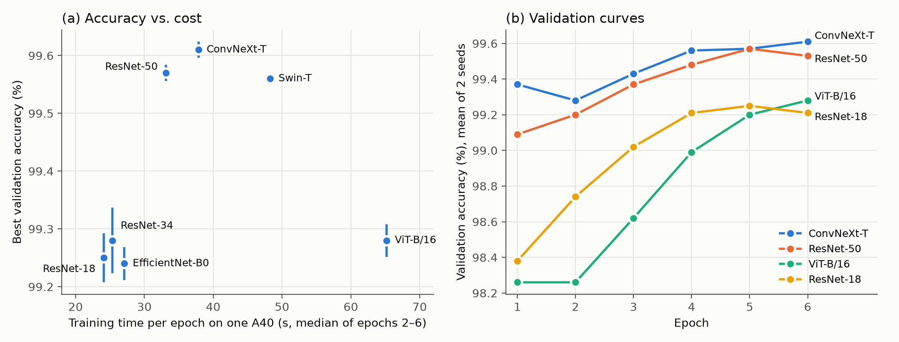

# Backbone Comparison under a Fixed Protocol  *(supplements item f, §8)*

> Long version; a condensed version is merged into the report as Section 7.8 (`sections/07_ablation.md`). Source data: `results/backbones.{csv,md}`,
> figure: `results/backbones.png`, per-run logs: `runs/backbones/b_<model>_s<seed>/history.csv`.
> All runs: NTU EEE Cluster 02, one NVIDIA A40 per job, 2026-10-31 (Slurm jobs 236593_0/1).

## Question

§8 compared models one change at a time against a ResNet-18 baseline. This
section asks a narrower question: **with the training recipe held fixed, how much
does the choice of ImageNet-pretrained backbone change validation accuracy on
Dogs vs. Cats, and what does it cost?** Seven torchvision backbones spanning
classic CNNs, an efficiency-oriented CNN, a modernised CNN and two vision
transformers were trained under one shared protocol.

## Protocol

Every config in `configs/dogs_cats/backbones/` is identical except the model name
and the batch size needed to fit memory (ViT-B/16 uses 32 × 2 gradient-accumulation
steps, so the effective batch is 64 for every model).

| Setting | Value |
|---|---|
| Data | full course split: 20,000 train / 5,000 val (balanced) |
| Input | 224 × 224, ImageNet normalisation |
| Augmentation (train only) | RandomResizedCrop (scale 0.6–1.0), horizontal flip p = 0.5 |
| Initialisation | torchvision `DEFAULT` ImageNet weights, all layers trainable |
| Loss | cross-entropy, label smoothing 0.1 |
| Optimiser | AdamW, head lr 1e-3, backbone lr 1e-4 (0.1×), weight decay 0.05 |
| Schedule | 1 warm-up epoch, then cosine decay; **6 epochs, no early stopping** |
| Other | mixed precision, gradient clipping at norm 1.0, effective batch 64 |
| Repeats | seeds 0 and 1 for every model (14 runs) |

Early stopping was disabled on purpose so that every model receives exactly the
same optimisation budget; otherwise a model with a noisy early validation curve can
be cut off before it converges.

## Results

| Backbone | Params (M) | ImageNet-1k top-1 of the weights* | Best val acc (%) | Last-epoch val acc (%) | s / epoch† |
|---|---:|---:|---:|---:|---:|
| **ConvNeXt-T** | 27.8 | 82.5 | **99.61 ± 0.01** | **99.61 ± 0.01** | 37.8 |
| ResNet-50 | 23.5 | 80.9 (V2) | 99.57 ± 0.01 | 99.53 ± 0.01 | 33.2 |
| Swin-T | 27.5 | 81.5 | 99.56 ± 0.00 | 99.54 ± 0.03 | 48.3 |
| ViT-B/16 | 85.8 | 81.1 | 99.28 ± 0.03 | 99.28 ± 0.03 | 65.2 |
| ResNet-34 | 21.3 | 73.3 (V1) | 99.28 ± 0.06 | 99.22 ± 0.03 | 25.4 |
| ResNet-18 | 11.2 | 69.8 (V1) | 99.25 ± 0.04 | 99.21 ± 0.01 | 24.1 |
| EfficientNet-B0 | 4.0 | 77.7 | 99.24 ± 0.03 | 99.18 ± 0.03 | 27.1 |

Mean ± std over two seeds. On the 5,000-image validation set, 0.02 percentage
points = 1 image.
\* Top-1 accuracy that torchvision reports for the exact checkpoint loaded (`DEFAULT` weights).
† Median of epochs 2–6 on one A40 (epoch 1 includes data-loader and cuDNN warm-up).



**Figure B1.** (a) Best validation accuracy against training cost per epoch; bars
are ±1 std over two seeds. (b) Validation accuracy per epoch (mean of two seeds)
for four representative backbones.

## Analysis

1. **Two clear tiers, and the gap is real.** ConvNeXt-T, ResNet-50 and Swin-T
   reach 99.56–99.61%, while the other four sit at 99.24–99.28%. The ≈0.3-point gap
   is about 15 validation images, whereas seed-to-seed spread is at most 0.06
   points (3 images). Differences *within* a tier (e.g. ConvNeXt-T vs ResNet-50,
   0.04 points = 2 images) are inside the noise and should not be used to rank
   those models.

2. **Accuracy follows the quality of the pretrained weights more than model size.**
   Parameter count is a poor predictor: ViT-B/16 has 3× the parameters of
   ConvNeXt-T yet ties ResNet-34. The top tier consists of the three backbones whose
   checkpoints score ≥ 80.9% on ImageNet. The ResNet family shows this most
   directly. ResNet-18 → ResNet-34 adds depth but gains only 0.03 points (noise).
   ResNet-34 → ResNet-50 gains 0.29 points, and the ResNet-50 checkpoint is
   torchvision's V2 weights, trained with a modern recipe (80.9% top-1 vs 73.3%).
   This experiment therefore cannot separate "deeper bottleneck architecture" from
   "better pretraining recipe"; we report it as a confounded comparison. This is
   consistent with §8's finding that pretraining dominates: the downstream task
   inherits much of its accuracy from the upstream representation.

3. **ViT-B/16 is under-trained in this budget, not necessarily worse.** Its
   validation curve (Fig. B1b) starts lowest (98.26% after two epochs) and is still
   rising at epoch 6, while the CNNs and Swin-T have flattened by epoch 4–5. Plain
   ViTs lack the locality bias of convolutions and the hierarchical windows of
   Swin, and are known to need longer fine-tuning or stronger regularisation. Under
   a fixed 6-epoch budget it is the worst trade-off measured: 2.7× the per-epoch
   time of ResNet-18 for the same accuracy. A longer schedule would be needed
   before concluding anything about ViT's ceiling on this task.

4. **The results do not depend on cherry-picking the epoch.** Best and last-epoch
   accuracies differ by ≤ 0.06 points for every model, and the two tiers are unchanged
   if the last epoch is used (only within-tier order shifts, e.g. Swin-T and ResNet-50 swap). Selecting the checkpoint on the validation set
   therefore inflates the reported numbers only marginally.

5. **Cost–accuracy recommendation.** ResNet-50 is the most efficient top-tier
   model (33 s/epoch, 99.57%). ConvNeXt-T buys the highest mean accuracy for 14%
   more time per epoch. Swin-T matches ResNet-50 at 45% more cost. When compute is
   tight, ResNet-18 loses only ≈0.3 points while running 1.6× faster than
   ConvNeXt-T. EfficientNet-B0 has the fewest parameters, but on a GPU it is no
   faster than ResNet-18 (depthwise convolutions are memory-bound), so its size
   advantage does not translate into training speed here.

6. **Relation to §8.** §8 measured ConvNeXt-T at 99.58% and ResNet-50 at 98.92%
   under a different recipe (160 px, 15 epochs, two-stage fine-tuning). The
   ConvNeXt-T figure is reproduced almost exactly with 40% of the epochs. The
   ResNet-50 figure differs by 0.65 points; candidate explanations are the input
   resolution (224 vs 160 px, which §8 itself found to matter by ≈0.7 points) and
   the protocols' different fine-tuning schedules. We did not run the ablation
   that would isolate this.

## Limitations

- Only two seeds per model, so the stds are rough; the between-tier conclusion holds
  comfortably, the within-tier ordering does not.
- Validation accuracy is used both to select the best epoch and to report results;
  there is no separate held-out labelled set for this comparison (the test set has
  no labels).
- One shared recipe (lr, augmentation, 6 epochs) was tuned for CNN fine-tuning and
  may disadvantage the transformers, especially ViT-B/16.
- Timing comes from two jobs running concurrently on the same node (separate A40s,
  shared CPUs and storage); absolute seconds are indicative, relative ordering is reliable.

## Reproduce

```bash
cd deliverables_He
bash scripts/run_backbones.sh                       # local; or on the cluster:
sbatch cluster/backbones.sbatch                     # see CLUSTER_GUIDE.md §5.4
python scripts/summarize_backbones.py               # -> results/backbones.{csv,md}
python scripts/plot_backbones.py runs/backbones results/backbones.png   # needs matplotlib
```
